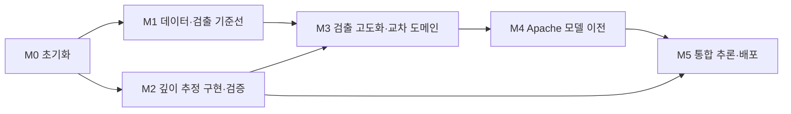

# gpr_detection 로드맵

작성 2026-10-29. 목표: GPR B-scan에서 매설 관로를 검출하고, 관로마다 지표에서의 깊이(m)를 추정한다. 세부 업무와 진행 표시는 [`CHECKLIST.md`](CHECKLIST.md), 규칙은 [`../CLAUDE.md`](../CLAUDE.md)를 본다. 단계 하나·체크리스트 항목 하나가 끝날 때마다 커밋하고 push한다.

## 한눈에 보기

**M2는 M1의 산출물에 의존하지 않는다**(그림에 M1→M2 화살표가 없다). M2가 쓰는 io 로더(M1-1·M1-2)는 이미 끝났고, 깊이 모듈은 원본 (트레이스, 샘플) 좌표 박스만 받는다. 합성은 정답 json의 꼭짓점(`apex.trace_index`·`apex.envelope_peak_ns`) 주변 창으로 박스를 만들고, 4TU는 손으로 고른 꼭짓점 씨앗(`fourtu_explore.md` §6, 39개)을 써서 검출기 없이 구현·검증한다. 좌표 역변환 함수(L2→L1→L0)는 M1-8에서 구현하고, 실측 입력 경로(M3-2)와 검출 박스→깊이 결합(M3-1, M5)은 M3 이후에 한다. 두 갈래가 공유하는 `GridBox` 타입은 M1-8에서 `io/radargram.py`에 추가하고 M2-3이 그것을 쓴다.

**진행 순서(사용자 결정 2026-10-29)**: M1-3 → M1-4~M1-8(M1-5 누수 감사·M1-6 데이터셋 카드 포함) → M1-9 → M1-0b(디코딩 판정 재측정, CPU가 빌 때) → M1-10 순서로 진행하고, **M1-10(5-fold 장시간 GPU 학습)이 도는 동안 M2를 시작**한다. 학습 데이터 로더가 CPU 디코딩을 쓰므로 M2 작업은 E코어로 묶어(`--affinity` 또는 compute-scheduler-expert 배치표) 학습 로더와 겹치지 않게 하고, 시작 전에 자원 현황을 확인한다.

## 단계별 계획

| 단계 | 목표 | 주요 산출물 | 완료 기준 | 담당 |
|---|---|---|---|---|
| **M0 초기화** | 조사·환경·에이전트·검증 자산 준비 | `docs/research/`, `docs/datasets/`, env 3개, 프로젝트 에이전트 3개, gprMax 합성 세트 20개, ADR | env `pip check` 통과, 에이전트 3개 시험 통과, 합성 꼭짓점이 이론 t0와 2 cm 이내, ADR 3건 승인 | 메인 세션, web-research-expert, electromagnetic-simulation-expert, add-architect |
| **M1 데이터·검출 기준선** | 누수 없는 학습 데이터와 YOLO11m 기준선 | `src/gpr_detection/io/`, `scripts/build_yolo_dataset.py`, `data/splits/*.csv`, 데이터셋 카드, `configs/train_yolo11m_*.yaml`, 기준선 리포트 | 분할 누수 단언 통과(세션·gain 크롭 키), 4클래스 data.yaml, YOLO11m 기준선 mAP50(AIHub 세션 그룹 5-fold 평균±표준편차) 보고 | python-expert, gpr-dataset-curator, cv-detection-expert |
| **M2 깊이 추정 구현·검증** | 물리 기반 깊이 추정 모듈과 판정 | `src/gpr_detection/preprocess/`·`depth/`, `tests/depth/`, `pipe_band` 깊이 명세, 4TU 검증 리포트 | 합성 회귀 R1–R13 통과(시험별 허용치는 spec §11-2: R6·R13(M20 공기결합)·R9(지면결합 보정) ≤2 cm, R7(공기층 단일 사건) 0~+5 cm, R8(지면결합 직접파 영점) −5~0 cm, R10 ≤5 cm·v ±6 %), 4TU 활동 단위 MAE와 제186조 깊이 ±30 cm 판정률 보고(t0 두 값·깊이 기준점 두 가정) | gpr-processing-expert, python-expert, electromagnetic-simulation-expert |
| **M3 검출 고도화·교차 도메인** | 실측 데이터로 일반화 확인 | 교차 도메인 평가 리포트, GPR-SD 수동 라벨, 라벨 오류 감사, 개선 실험 | AIHub→모로코·4TU·GPR-SD 평가 보고, GPR-SD 관로 17건 박스 라벨 완료, 라벨 오류 후보 검토 | cv-detection-expert, gpr-dataset-curator |
| **M4 Apache 모델 이전** | 라이선스 문제 없는 검출기로 교체 | RF-DETR(S/M 우선, 필요 시 N/L) 학습·비교 리포트, `detect/` 교체 | 같은 분할·k-fold로 YOLO11m 대비 `이전 가능` 판정, 비율 유지 입력 경로 확인 | cv-detection-expert, python-expert |
| **M5 통합 추론·배포** | 입력 파일 → 박스+깊이 결과 | `gpr-detect infer` CLI, ONNX 추론, README·사용 문서 | npy/SEG-Y 1건 → JSON+PNG, ONNX 출력이 원본과 일치, 배포물에 AGPL 가중치 없음 | python-expert, cv-detection-expert, integrity-checker |

## 확정된 설계 결정 (2026-10-29)
- M1 학습 데이터·설정: AIHub B-scan 4클래스(공동·맨홀은 관로 규모로 축소, gain 세 벌 사용), 모로코는 평가 전용, YOLO11m은 사전학습 없이 scratch·imgsz 256, epoch는 M1-9 smoke 뒤 결정(CHECKLIST "M1 결정 사항").
- 검출 학습·비교는 AIHub test 세션 홀드아웃(약 15 %, 관로 비중 10–25 %) 뒤 나머지를 세션 그룹 5-fold(기준선 포함)로, 이전 판정은 전체 mAP50 fold 평균 −5 %p 이내면 `이전 가능`(두 등급, ADR-001·003). 좌표 역변환은 pipeline이 L2→L1→L0로 공통 처리(README §2-3). 4TU는 깊이 튜닝 없이 13개 현장 전체를 시험에만 쓴다.
- 검출은 YOLO11m 초안 → 성능 확보 후 Apache 계열(1순위 RF-DETR N/S/M/L)로 이전. YOLO 의존은 `detect/`에만.
- 깊이는 물리 기반 쌍곡선 피팅. 공기결합(4TU)은 지표 반사 영점, v는 메타 εr 고정 또는 굴절 모델(곡률 피팅 금지). 반경은 피팅 미지수로 넣지 않는다.
- 클래스 4개: `pipe_hyperbola`(tpipe·모로코 pipe), `pipe_band`(lpipe), `cavity`, `manhole`. 깊이 피팅은 `pipe_hyperbola`에만.
- 분할: AIHub는 세션(`source`) 단위·gain 사본 묶음, 모로코는 제공 그룹 단위·회전·탄성 사본 제외(`aug_transform` 기준), 4TU는 현장 단위.
- 증강: 상하 반전·회전·mosaic·색상 증강 금지(`docs/experiments/augmentation_policy.md`).

## 열린 문제와 위험

| 항목 | 영향 | 대응 | 단계 |
|---|---|---|---|
| AIHub 71327 세로축 스케일(ns/px)·장비 코드 정의 미확보 | AIHub 영상에서 m 단위 깊이 불가 | 사용자가 AIHub 활용가이드 다운로드 → 문서 에이전트 추출 | M1–M2 |
| AIHub 관로 독립 세션이 lpipe 13·tpipe 11개뿐(전부 NM 장비) | 검출 성능 분산 큼, 장비 편향 | 세션 단위 k-fold, 모로코·실측으로 교차 평가 | M1·M3 |
| 4TU 깊이 정답 기준점(상단/중심) 미정, εr 메타가 실측 아닐 가능성, Tx–Rx 간격 미확인 | 깊이 판정 편향 | 두 가정 모두 보고, εr 불확도 15 % 가정 | M2 |
| 4TU 트렌치 거리 ↔ 측선 트레이스 대응 없음 | 수평 위치 비교 불가 | 활동 단위 깊이 집합 헝가리안 매칭 | M2 |
| GPR-SD dt 가설 A/B 미확정(±16 %), 영점 미확정(지표 에코 제거된 처리본) | dt 가설은 εr·v 해석만 바꾸고 곡률 기반 깊이는 불변(spec U5). 깊이 불확도는 영점 미확정(`zero_unverified`)에서 온다 | εr 해석 확정과 영점 점검 | M3 |
| 모로코 공동 하위셋 전체가 비율 무시 224×224 늘림 | 공동 쌍곡선 비등방 왜곡, 공동 지표 왜곡 | 회전·탄성 사본 제외와 별개로 공동 지표를 도메인별로 분리 | M1·M3 |
| RF-DETR 기본 정사각 리사이즈 | 쌍곡선 형태 왜곡, 비교 불공정 | 비율 유지 경로 확인 후 비교 | M4 |
| Ultralytics AGPL(학습 가중치 포함) | 배포 제약 | 배포 전 M4 이전 완료, 법무 판단은 사용자 | M4–M5 |
| 4TU 공기층 0.1 m급에서 직접파·지표 반사 합쳐짐 | 깊이 +1.8–3.6 cm | `air_single_event` 플래그와 편향 상한 | M2 |
