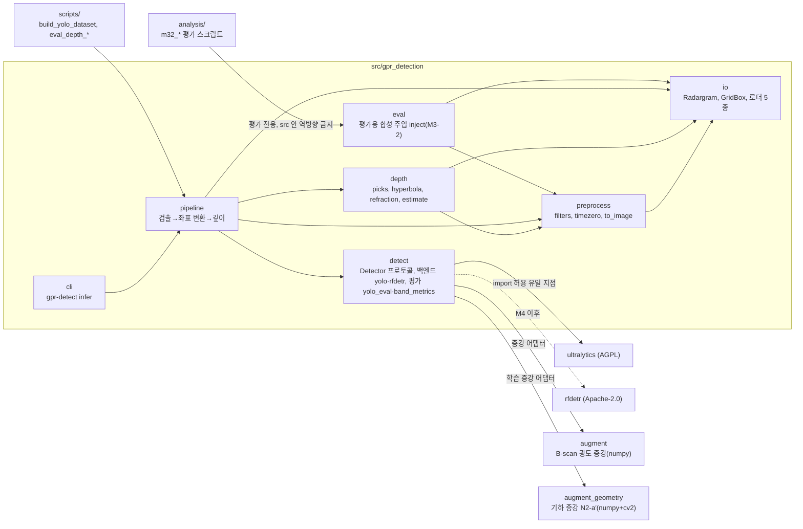
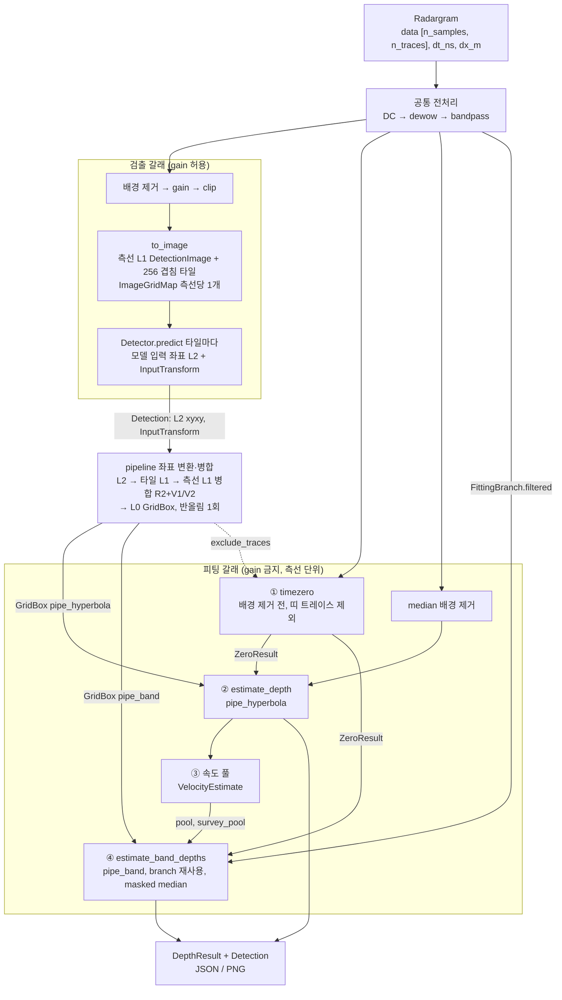

# gpr_detection 아키텍처 개요

- 작성: add-architect (ADD 3.0 design 모드), 2026-10-29 — 체크리스트 M0-12
- 설계 목적: **greenfield**. 2026-10-29 기준 `src/`에는 M1-1·M1-2 구현분(`io/radargram.py`, `io/classes.py`, `io/annotated.py`, `io/paths.py`, `io/_common.py`, 로더 5종 `io/{aihub,morocco,fourtu,guangzhou,gprsd}.py`, `io/_vendor/`, `cli.py` 스텁)만 있다. M1-7·M1-8(2026-10-29)로 §2-3 스케치의 타입(`GridBox`·`PixelBox`·`Detection`·`DetectorOutput`·`InputTransform`·`ImageGridMap`), `pipeline.py` 역변환, `augment.py`가 코드에 들어갔다. 스케치는 구현에 맞춰 고쳤다. 이 문서는 M1–M2 구현 전에 모듈 경계와 두 갈래(검출·깊이)의 좌표 계약을 고정한다.
- 결정 기록: [ADR-001 검출기 이전](ADR-001-detector-migration.md), [ADR-002 물리 기반 깊이](ADR-002-physics-based-depth.md), [ADR-003 데이터 분할·클래스](ADR-003-data-split-and-classes.md), [ADR-004 좌표 계약](ADR-004-coordinate-contract.md)(2026-10-30, §2-3 결정을 옮겨 기록)
- 근거 표기: 사용자·문서가 준 사실은 그대로, 문서에서 추론한 것은 `[추정]`, 이 문서에서 채운 값은 `[가정]`.

## 1. 설계 드라이버

### 1-1. 주요 기능 (FR)

| ID | 기능 | 근거 |
|---|---|---|
| FR-1 | B-scan 영상에서 4개 클래스(`pipe_hyperbola`, `pipe_band`, `cavity`, `manhole`) 박스 검출 | ROADMAP 확정 결정, ADR-003 |
| FR-2 | 물리 스케일(dt_ns, dx_m)이 있는 입력에서 `pipe_hyperbola` 박스마다 관 상단 깊이(m)·불확도·플래그 산출. `pipe_band`는 띠 상단 시각으로 깊이를 내되 v 출처가 없으면 `no_velocity`(2026-10-30, ADR-002 결정 8) | CLAUDE.md, spec_depth_v1 §2, spec_band_depth_v1 §4–§6 |
| FR-3 | 스케일이 없는 입력(AIHub·모로코 JPG)은 꼭짓점 픽셀·시간 위치와 `no_scale`만 산출 | spec_depth_v1 §0-1, §7 순서 1 |
| FR-4 | `gpr-detect infer <파일>` → 박스 + 깊이 JSON/PNG | ROADMAP M5 |
| FR-5 | 검증 경로(검출: AIHub test 홀드아웃 1회 측정 + train_pool 5-fold): gprMax 합성 회귀(R1–R13), 4TU 활동 단위 깊이 검증(13개 현장 전체, 튜닝 없음), 검출 mAP(AIHub 세션 그룹 k-fold) | ROADMAP M1·M2, 사용자 답변 2026-10-29 |

### 1-2. 품질 속성 시나리오 (QA)

| ID | 속성 | 자극원 | 자극 | 대상 | 환경 | 응답 | 응답 척도 | 우선순위 (중요도, 난이도) |
|---|---|---|---|---|---|---|---|---|
| QA-1 | 변경 용이성 (modifiability) | 개발자(python-expert) | YOLO11m을 RF-DETR S/M으로 교체 | `detect/` 와 학습 설정 | M4, 같은 분할·같은 증강 정책 | `Detector` 구현 하나 추가, 설정에서 선택. 이전 판정은 YOLO11m 대비 전체 mAP50 −5 %p 이내(ADR-001) | `detect/`·`configs/` 밖 코드 변경 **0줄**(백엔드 변환이 `InputTransform` 스키마 안에 들 때), `detect/` 밖 `ultralytics` import **0건**(정적 검사), 교체 작업 ≤ 2 인일 `[가정]` | (H, M) |
| QA-2 | 정확성 — 합성 깊이 | 회귀 시험 | gprMax 합성 20개 입력 | `preprocess/`·`depth/` | `pytest -m synthetic`, 시드 0 | 깊이·v·영점 산출 | spec §11-2 기준: R6·R13(M20 공기결합)·R9(지면결합 보정) ≤ 2 cm, R7(공기층 단일 사건 M12·13·15·18) 0 < d−d_top ≤ 5 cm, R8(지면결합 직접파 영점, 얕은 쪽 편향) −5 ≤ d−d_top < 0 cm, R10 ≤ 5 cm·v ±6 %, 실패 0건 | (H, H) |
| QA-3 | 정확성 — 실측 깊이 | 검증 스크립트 | 4TU 13개 현장 활동 | `depth/` + 4TU 로더 | 공기결합, εr 메타 미검증 | 활동 단위 헝가리안 매칭 후 깊이 비교 | MAE(m)와 **공공측량 작업규정 제186조 깊이 ±30 cm 판정률(n/N)** 보고. t0 두 값 × 기준점 상단/중심 두 가정 = 4조합 모두 보고. 깊이 파라미터는 4TU로 튜닝하지 않고 합성에서 정한 기본값으로 13개 현장 전체를 시험에만 쓴다. 목표(U-3, 사용자 확정 2026-11-07, [`preregistration_4tu_reeval_v1.md`](../processing/preregistration_4tu_reeval_v1.md), [`CHECKLIST.md`](../CHECKLIST.md) U-3): `main`(B+D+E)·관 상단·검출 영점·X 제외에서 판정률 B ≥ 0.25(388개 중 97개) **그리고** 활동 범위 무작위 기준선(같은 추정 수, 1,000회, 시드 0) 대비 단측 p < 0.05. 판정은 4TU 재평가 1회로 한다. 기준선이 짝의 약 95 %를 맞혀 p 조건으로 불합격할 가능성이 높다는 점을 알고 유지한 목표다 | (H, H) |
| QA-4 | 정확성 — 단위 오용 방지 | 사용자 | 스케일 없는 JPG를 `infer`에 입력 | `depth/estimate`, `pipeline` | 정상 운용 | 깊이 m 값을 내지 않음 | m 단위 깊이 출력 **0건**, 모든 결과 `status="no_scale"`(U7 시험) | (H, L) |
| QA-5 | 재현성 — 누수 방지 | 데이터 빌드 스크립트 | 분할 매니페스트 생성 | `scripts/build_yolo_dataset.py`, `data/splits/` | 빌드 시마다 | 분할 간 그룹 키 교집합 단언 | AIHub 세션(`source`)·gain 제거 크롭 키, 모로코 그룹, 4TU 현장 교집합 **0건**. 위반 시 빌드 실패 | (H, L) |
| QA-6 | 재현성 — 결정성 | 개발자 | 같은 설정·시드로 재실행 | 분할·학습·깊이 | 같은 env 버전 | 같은 결과 | 분할 매니페스트 바이트 동일, 깊이 결과 동일(RANSAC `random_state=0`), 검출 mAP50은 AIHub 세션 그룹 k-fold(기준선 포함, 분할 시드 기록) fold 평균±표준편차로 보고 | (M, M) |
| QA-7 | 라이선스 (license compliance) | 배포 담당 | M5 배포물 생성 | 배포 패키지·가중치 | 배포 전 점검 | AGPL 산출물 배제 | 배포물 안 Ultralytics 코드·YOLO 학습 가중치 **0개**, RF-DETR은 N/S/M/L(Apache-2.0)만 | (H, M) |
| QA-8 | 정확성 — 좌표 계약 | 시험 | 원본 격자 박스 → 검출 이미지 → 원본 격자 왕복 | `preprocess/to_image`, `detect` 래퍼 | 4TU·합성 npy, 비정사각 입력 | 원본 (trace, sample) 복원 | 왕복 오차 ≤ 1 trace·1 sample(사용자 확정 2026-10-30). 바깥쪽 반올림: 격자에 맞춘 박스는 오차 0 왕복, 검출 박스는 각 변 1셀 미만만 넓어짐 | (H, M) |

- 중요도는 사용자 결정 사항(검출기 교체 계획, 제186조 판정, 누수 방지, AGPL 회피)에서 옮겼다. 난이도 H/M/L은 `[가정]`이다.
- 성능(추론 지연·처리량) 시나리오는 드라이버에 없다. 이 프로젝트의 현재 목표는 오프라인 분석이라고 `[추정]`하고 넣지 않았다(§6 백로그).

### 1-3. 제약 (CON)

| ID | 제약 |
|---|---|
| CON-1 | Python 3.13, Windows 11, conda env: `gpr-dev`(ultralytics 8.4.192, torch 2.14.1+cu130), `gpr-detr`(rfdetr 1.11.2, **ultralytics 없음**), `gpr-label` |
| CON-2 | GPU 1장 RTX 4070 SUPER 12 GB, 한 번에 한 계열 GPU 작업 |
| CON-3 | Ultralytics는 AGPL-3.0(학습 산출 모델 포함, 사내 사용도 Enterprise 대상이라고 명시) — `docs/research/packages.md` |
| CON-4 | 원본 데이터 `C:\workspace\GPR_Data`는 읽기 전용. AIHub zip은 풀지 않고 읽는다 |
| CON-5 | AIHub·모로코는 물리 스케일 없음(AIHub permittivity 6.0은 자리채움) |
| CON-6 | 저장소는 공개(GitHub). `data/`·`runs/`는 git 제외 |
| CON-7 | `.py` 구현은 python-expert, 물리 판정은 gpr-processing-expert·electromagnetic-simulation-expert(팀 분업) |

### 1-4. 아키텍처 관심사 (CRN)

| ID | 관심사 |
|---|---|
| CRN-1 | 설정 관리: 깊이 기본값은 `DepthConfig` 하나, 검출은 `configs/train_*.yaml` |
| CRN-2 | 시험 가능성: 앱 없이 모듈 단위 시험(`tests/depth/` U1–U8, R1–R13), `@pytest.mark.synthetic` |
| CRN-3 | 결과 추적: `DepthResult`의 `zero_rule`·`v_rule`·`flags`·`bias_notes`로 어떤 규칙이 쓰였는지 남긴다 |
| CRN-4 | env 분리: 패키지 import가 `gpr-detr`(ultralytics 없음)에서도 성공해야 한다 → `detect/`의 백엔드는 지연 import |

### 1-5. Utility tree

| 품질 속성 | 세부 속성 | 시나리오 |
|---|---|---|
| 정확성 | 합성 깊이 | QA-2 (H, H) |
| | 실측 깊이(제186조) | QA-3 (H, H) |
| | 단위 오용 방지 | QA-4 (H, L) |
| | 좌표 계약 | QA-8 (H, M) |
| 변경 용이성 | 검출기 교체 | QA-1 (H, M) |
| 재현성 | 누수 방지 | QA-5 (H, L) |
| | 결정성 | QA-6 (M, M) |
| 라이선스 | AGPL 배제 | QA-7 (H, M) |

(H, H)인 QA-2·QA-3이 깊이 갈래 구조(ADR-002)를, QA-1·QA-7이 검출 갈래 경계(ADR-001)를, QA-5가 데이터 경로(ADR-003)를 결정한다.

## 2. 최상위 구조 (반복 1 결과)

### 2-1. 설계 개념 선택

| 후보 | 장점 | 단점 | 판정 |
|---|---|---|---|
| **A. 단일 패키지 계층형(모듈러 모놀리스) + 두 갈래 파이프라인** | 단순, 모듈 시험 쉬움, 의존 방향 강제 가능 | 모듈 경계를 규칙(정적 검사)으로 지켜야 함 | **채택** (QA-1, QA-2, CRN-2) |
| B. 검출·깊이를 별도 패키지/서비스로 분리 | 경계가 물리적으로 강제됨 | 오프라인 분석 프로젝트에 배포·버전 관리 부담, 드라이버 없음 | 기각(과잉) |
| C. Ultralytics 파이프라인에 깊이를 콜백으로 붙임 | 코드 적음 | AGPL·Ultralytics API가 깊이 쪽까지 퍼져 QA-1·QA-7 위반 | 기각 |

### 2-2. 모듈 뷰



화살표는 "import한다"이다. 검증: Mermaid Chart 검증 도구 통과(2026-10-29). `augment_geometry` 노드 추가 뒤 Mermaid Chart 검증 도구·mmdc 렌더 다시 통과(2026-11-14). `scripts/train_detector.py`도 `augment_geometry`를 직접 import하지만 `scripts/` 화살표는 대표만 그렸다. `eval` 노드·`analysis/` 노드 추가(2026-11-14, M3-2 선행) 뒤 점검 결과는 §7 변경 이력에 적는다. `tests/`는 그리지 않았다(시험은 모든 모듈을 import할 수 있다).

| 모듈 | 책임 | 드라이버 |
|---|---|---|
| `io` | `Radargram`(spec §1-1)과 데이터셋별 로더, 원본 격자 박스 `GridBox`. 메타 t0 샘플 → ns 변환. 스케일 없는 입력은 `dt_ns=None` | FR-2, FR-3, QA-4, CON-4 |
| `preprocess` | `filters`(DC·dewow·bandpass·median 배경 제거·AGC), `timezero`(영점 사건 검출·선택), `to_image`(검출 갈래 영상화와 `ImageGridMap`. M3-1: 측선 L1 `DetectionImage`(C′ 배율)·256×256 겹침 타일 `LineTile`) | QA-2, QA-8 |
| `detect` | 두 종류의 파일을 둔다. **백엔드 파일**: 백엔드 래퍼(`yolo.py`, M4에 `rfdetr.py`), 학습 어댑터(`yolo_train.py`, 증강 본체는 최상위 `augment.py`), 백엔드 평가(`yolo_eval.py`) — ultralytics·rfdetr를 함수 안에서 지연 import한다. **백엔드 무관 파일**: `Detector` 프로토콜·계약 타입(`base.py`, `__init__.py`), `pipe_band` 보조 지표(`band_metrics.py`, 2026-11-01: 띠 x구간 합집합·세로 겹침 기준·층 묶기·가로 구간 재현율/정밀도·분절 수·Ultralytics와 같은 결과를 내는 AP50, numpy만 사용, U-3 띠 목표의 계산 근거 `docs/experiments/2026-11-01_m110_baseline.md` §6-1) — 검출 라이브러리를 import하지 않으므로 `gpr-dev`·`gpr-detr` 양쪽에서 같은 코드로 YOLO11m·RF-DETR 예측을 채점한다. **ultralytics·rfdetr import는 `detect/` 안에만**(밖 0건) | QA-1, QA-7, CRN-4, FR-5 |
| `augment` | 백엔드 공통 B-scan 광도 증강 4종(가우시안 잡음·대비/감마·수평 띠 잡음·트레이스 누락). numpy만 사용(torch·cv2·ultralytics·rfdetr 금지) | QA-1, M1-7 |
| `augment_geometry` | 검출(`detect`) 쪽 **학습 증강**의 기하 부분(M3-1 N2-a·N2-a′, 2026-11-13–14): 등방 축척(축소 AREA·확대 LINEAR), 정수 열 가로 이동, 가장자리 채움 띠, N2-a′ 문맥 모드(같은 line·gain·fold의 겹친 train crop 이어 붙이기 `ContextIndex`·`assemble_context_strip`·`place_window`·`augment_context_scale`), 박스 유지 규칙. 표준 라이브러리 + **numpy + cv2**만 import하고 검출 라이브러리·torch는 import하지 않는다. cv2를 쓰므로 `augment`(규칙 5)와 분리한 모듈이다. 사용처는 `detect/yolo_train.py`(Ultralytics 어댑터)와 `scripts/train_detector.py`이고, M4-2에 RF-DETR 어댑터도 같은 모듈을 쓴다(ADR-001 결정 4, 같은 증강으로 비교) | QA-1, FR-1, ADR-001 |
| `depth` | 점 추출·RANSAC·least_squares(R 고정)·굴절 모델·v 결정표·불확도 → `DepthResult`. M2-6b: `band.py`(띠 상단 픽·masked median·flat/sloped/curved)·`velocity.py` 속도 풀(`VelocityEstimate`, `select_band_velocity`) | FR-2, QA-2, QA-3 |
| `pipeline` | 두 갈래를 조립하고 클래스 필터(깊이는 `pipe_hyperbola`·`pipe_band`, `cavity`·`manhole` 제외)와 좌표 변환을 적용. M3-1(2026-11-13, `abbe8dc`): 타일 박스를 측선 L1 연속 좌표에서 병합(R2 + 물리 거부권 V1·V2, 띠 구간 중재, `merge_line_boxes`)한 뒤 L0로 한 번 반올림하고(`line_boxes_to_grid`, 묶음 `detect_line`), 측선 단위 깊이 호출 순서(ADR-004 결정 7)를 `estimate_line_depths`·`estimate_survey_depths`로 구현. CLI 연결은 M5-1 | FR-2, FR-4, QA-8 |
| `eval` | **평가 전용** 합성 주입(M3-2 S4, `eval/inject.py`, [`m32_image_quality_plan.md`](../processing/m32_image_quality_plan.md) §3-2·§5-3·§8): 실측 배경 측선에 gprMax 관 단독 응답을 넣고 의사 띠를 만들어, 정답 L0 박스(`GridBox`)와 주입 집합 표(시드 고정, sha)를 낸다. `select_zero`·`make_detection_image` 등 `io`·`preprocess`의 공개 함수만 쓴다. **학습·추론 경로에 들어가지 않는다**(`detect`·`pipeline`·`depth`·`cli`는 `eval`을 import하지 않음, 규칙 9). 좌표: 정답 박스는 주입한 원본 격자 위치에서 바로 L0 정수로 내고, L1 표현이 필요하면 `ImageGridMap` 순변환(L0 → L1)만 쓴다. L1 → L0 역변환·반올림은 하지 않는다(ADR-004: 역변환은 `pipeline` 한 곳) — 왕복 확인은 시험(S6 (g))에서 `pipeline`과 맞춰 본다. gprMax 출력 파일 읽기는 `eval` 밖(호출하는 분석 스크립트)에서 하고 배열로 넘긴다 `[가정]`. 대안: (a) `analysis/` 스크립트 안에 두기 — 패키지 시험(`tests/test_inject.py`)·재사용이 어렵다, (b) `preprocess` 안에 두기 — 평가 코드가 학습·추론 경로와 섞이고 역방향 금지를 정적으로 강제할 수 없다. 새 최상위 패키지로 얻는 것은 경계 강제와 시험 가능성, 잃는 것은 패키지 하나와 규칙 두 개의 유지 비용 | FR-5, QA-8, QA-6, CRN-2, CRN-4 |
| `cli` | `gpr-detect infer` | FR-4 |
| `scripts/` | 데이터 빌드·평가 진입점. 패키지를 import하고 **패키지는 `scripts/`를 import하지 않는다** | QA-5, FR-5 |

의존 규칙(정적 검사로 시험한다, CRN-2):
1. `detect`와 `depth`는 서로 import하지 않는다. 둘을 만나게 하는 곳은 `pipeline`뿐이다.
2. `io`는 패키지 안 다른 모듈을 import하지 않는다.
3. `ultralytics`·`rfdetr` import는 `src/gpr_detection/detect/` 아래 백엔드 파일에만, 함수 안 지연 import로 둔다(`gpr-detr` env에 ultralytics가 없다, CON-1). "`detect/` 안에만"은 상한이다 — `detect/` 안의 모든 파일이 검출 라이브러리에 의존한다는 뜻이 아니다. 백엔드 무관 파일(`__init__.py`, `base.py`, `band_metrics.py`)은 검출 라이브러리를 import하지 않는다(시험: `tests/test_architecture_rules.py`의 `NEUTRAL_DETECT_MODULES`에 `__init__.py`·`base.py`·`band_metrics.py`가 들어 있고, 런타임 probe도 `band_metrics`를 import한다. `band_metrics.py`의 import 허용 목록은 아래 규칙 6).
4. `src/`는 `scripts/`를 import하지 않는다(spec §6-1: `ray_geometry` 알고리즘은 `depth/refraction.py`로 옮겨 구현).
5. `augment`는 torch·cv2·ultralytics·rfdetr를 import하지 않는다(시험: `tests/test_architecture_rules.py`). `detect` → `augment` 의존은 허용(어댑터).
6. `detect/band_metrics.py`는 표준 라이브러리(`collections`, `dataclasses`)와 numpy만 import한다(시험: `tests/test_band_metrics.py::test_module_imports_numpy_only`, AST 허용 목록). 다만 `gpr_detection.detect.band_metrics`를 import하면 `detect/__init__.py` → `base.py`를 거쳐 cv2도 올라온다 — 두 env 모두 opencv가 있어(`gpr-dev` opencv-python, `gpr-detr` opencv-python-headless) 문제가 없다.
7. `augment_geometry`는 표준 라이브러리·numpy·cv2(와 `gpr_detection`)만 import하고 torch·ultralytics·rfdetr는 import하지 않는다(시험: `tests/test_architecture_rules.py`의 `test_augment_geometry_imports_only_the_allow_list`(허용 목록 numpy·cv2·stdlib·`gpr_detection`)와 `test_augment_geometry_allow_list_rejects_detector_imports`. ultralytics·rfdetr는 규칙 3의 패키지 전역 시험 `test_detector_libraries_only_in_detect_backends`도 잡는다). 두 env 모두 opencv가 있어 같은 코드를 YOLO·RF-DETR 학습에 쓴다.
8. `eval`(`src/gpr_detection/eval/` 아래 전부)은 표준 라이브러리·numpy·scipy와 `gpr_detection.io`·`gpr_detection.preprocess`(와 `gpr_detection.eval` 자신)만 import한다. `gpr_detection.detect`·`gpr_detection.pipeline`·`gpr_detection.depth`와 `ultralytics`(그리고 `rfdetr`·torch)는 import하지 않는다(시험: `tests/test_architecture_rules.py`에 허용 목록 시험을 추가한다 — M3-2 S4 구현과 같은 커밋). 직접 import만 제한한다 — `io/_common.py`를 거쳐 cv2가 올라오지만 두 env 모두 opencv가 있어 문제가 없다(규칙 6과 같은 사정). 그래서 `eval`은 `gpr-dev`·`gpr-detr` 양쪽에서 import된다(CRN-4).
9. `src/gpr_detection/` 안에서 `eval` 밖의 모듈(`gpr_detection/__init__.py` 포함)은 `gpr_detection.eval`을 import하지 않는다(평가 전용, 역방향 금지). `analysis/`·`scripts/`·`tests/`의 import는 허용한다(시험: 규칙 8과 같은 파일).

### 2-3. 두 갈래 데이터 흐름과 좌표 계약



검증: Mermaid Chart 검증 도구 통과(2026-10-29, `pipe_band` 경로 추가 뒤 다시 통과 2026-10-30, M3-1 타일·병합 레이블 갱신 뒤 Mermaid Chart·mmdc 통과 2026-11-14). 갈래 분리 근거는 spec_depth_v1 §3(피팅은 gain 없는 시간축, 영점은 배경 제거 전). 띠 갈래는 측선 전체 median 배경 제거 대신 박스 밖 트레이스로만 구한 masked median을 쓴다(spec_band_depth_v1 §3-2). ①–④는 측선 단위 호출 순서(ADR-004 결정 7)다. 영점·쌍곡선·띠는 같은 (1)–(3) 전처리 자료(`FittingBranch`, `prepare_depth_inputs`가 만든 `inputs.branch`)를 공유하고, ④는 `estimate_band_depths(..., branch=inputs.branch)`로 받는다(2026-10-31, M2-6b 구현). 조사 단위 풀(`survey_pool`)은 같은 조사 단위의 모든 측선에서 ②가 끝난 뒤 모은다.

좌표는 세 층이다. 각 층의 소유자와 변환 책임을 고정한다. **좌표 역변환(L2 → L1 → L0)은 `pipeline`이 한 곳에서 공통으로 한다**(사용자 결정 2026-10-29). 대안·트레이드오프·반올림 규칙 비교는 [ADR-004](ADR-004-coordinate-contract.md)에 있다.

| 층 | 좌표 | 정의 위치 | 다음 층으로의 변환 책임 |
|---|---|---|---|
| L0 원본 격자 | (trace `i`, sample `k`), 정수 인덱스, `data[k, i]` | `io` (`Radargram`, `GridBox`) | — (깊이는 이 층만 받는다, spec §1-2) |
| L1 검출 이미지 | 검출 입력 영상의 픽셀 (u, v), 리사이즈 후, **letterbox 전**. 실측(M3-1, C′)은 **측선 L1**(측선 전체를 한 번 리샘플) 연속 좌표이고, 타일 픽셀은 `u_line = u_tile + x0_px`(정수)로 옮긴다 | `preprocess/to_image` (`DetectionImage`, `LineTile`, `ImageGridMap`) | `pipeline`이 타일 L1 → 측선 L1(`tile_box_to_line_box`), 병합 뒤 `ImageGridMap`으로 측선 L1 → L0 |
| L2 모델 입력 | letterbox·정사각 리사이즈 후 텐서 좌표 | 각 `Detector` 백엔드가 만들고 `InputTransform`으로 공개 | `pipeline`이 `InputTransform`으로 L2 → L1 |

인터페이스(시그니처는 계약 설명용 스케치):

```python
class Detector(Protocol):
    class_names: tuple[str, ...]          # ("pipe_hyperbola", "pipe_band", "cavity", "manhole")
    def predict(self, image: np.ndarray) -> DetectorOutput: ...   # image: L1, uint8 [H, W] 또는 [H, W, 3]

# 선택 기능(프로토콜 밖, 2026-11-14 M3-2 S5). 구현: YoloDetector. RF-DETR(M4)은 미구현
#   def predict_batch(self, images: Sequence[np.ndarray]) -> list[DetectorOutput]: ...
#   입력 순서대로 한 장에 DetectorOutput 1개. 전처리·conf·iou·device는 predict와 같다

@dataclass(frozen=True)
class InputTransform:     # detect/base.py — 백엔드가 L1 → L2에 적용한 변환
    scale_x: float; scale_y: float   # L2 px / L1 px, 축별(정사각 늘림이면 서로 다름)
    pad_x: float; pad_y: float       # L2에서 왼쪽·위쪽 패딩(px)
    input_w: int; input_h: int       # L2 크기(검증용)

@dataclass(frozen=True)
class PixelBox:           # detect/base.py — 연속 픽셀 좌표(픽셀 j는 [j, j+1))
    x1: float; y1: float; x2: float; y2: float

@dataclass(frozen=True)
class Detection:          # detect/base.py
    class_id: int; class_name: str; score: float
    box: PixelBox                                # L2 픽셀(모델 입력 좌표 그대로)

@dataclass(frozen=True)
class DetectorOutput:
    detections: tuple[Detection, ...]
    transform: InputTransform

@dataclass(frozen=True)
class ImageGridMap:       # preprocess/to_image.py
    trace_offset: int; sample_offset: int        # L1 원점의 L0 위치. 측선 L1(M3-1)은 0 — 타일 원점이 아님
                                                 # (타일 원점은 LineTile.x0_px, 측선 L1의 정수 px)
    traces_per_px: float; samples_per_px: float  # 리사이즈 배율
    n_traces: int; n_samples: int                # 격자 크기(자르기용)
    # pipeline: u = (x − pad_x) / scale_x  (L2→L1),  i = trace_offset + u · traces_per_px  (L1→L0)
    #           셀 j는 [j, j+1). 박스 [t1,t2]는 닫힌 인덱스 floor(t1+1e-6) .. ceil(t2−1e-6)−1,
    #           영폭은 1셀, 격자 범위로 자르고 격자 밖이면 버린다(None). 이 규칙은 pipeline.py 한 곳에만 둔다
    #           타일 경로: L2 → 타일 L1 → (+x0_px) 측선 L1 LineBox → 병합 → 반올림 1회 → GridBox

@dataclass(frozen=True)
class LineTile:           # preprocess/to_image.py — 측선 L1의 256×256 타일
    index: int; x0_px: int                       # 타일 원점(측선 L1 정수 px)
    content_width_px: int; owner_px: tuple[float, float]
    inner_left: bool; inner_right: bool          # 이웃 타일과 맞닿은 변(잘림 판정용)

@dataclass(frozen=True)
class GridBox:            # io/radargram.py
    i0: int; i1: int; k0: int; k1: int           # 닫힌 구간, L0
```

계약 규칙:
- `Detector.predict`는 박스를 **L2(모델 입력) 좌표 그대로** 돌려주고, 자기가 적용한 L1 → L2 변환을 `InputTransform`으로 함께 낸다. letterbox(Ultralytics)든 정사각 리사이즈(RF-DETR `square_resize_div_64`)든 역변환은 백엔드가 하지 않는다.
- 선택 기능 `predict_batch(images)`(2026-11-14, M3-2 S5, ADR-001 결정 3 보충): 여러 L1 영상을 모델 호출 한 번으로 처리한다. `Detector` 프로토콜에는 넣지 않는다. 프로토콜은 `class_names`·`predict`만 요구한다.
  - 결과가 `predict`와 **마지막 자리까지 같지는 않을 수 있다.** letterbox·conf·iou·device는 같지만 GPU 커널의 반올림이 배치 크기에 따라 달라진다. YOLO11m 실측 점수 차는 최대 6.9e-4였다. 그래서 비트 단위 재현이 필요한 게이트는 batch 1(`predict` 경로)로 돌린다. 레시피 사이의 비교는 모든 레시피를 같은 배치 경로로 돌려서 한다(계획 [`m32_image_quality_plan.md`](../processing/m32_image_quality_plan.md) §4-3 C-8: 정체 게이트 `--batch-size 1`, 측정 batch 64).
  - 없으면 `predict`로 폴백한다. 호출자는 `getattr(detector, "predict_batch", None)`로 찾고, 없거나 batch ≤ 1이면 타일마다 `predict`를 부른다(`analysis/detection/m32_recipe_eval.py` `predict_tiles`). `pipeline`은 `predict`만 쓴다.
  - 위험: RF-DETR(M4) 래퍼가 `predict_batch`를 구현하지 않으면 러너가 **오류 없이 다른 경로(타일별 `predict`)로 돈다.** 기록에는 요청한 `batch_size`만 남는다. 그러면 YOLO11m(batch 64)과 RF-DETR(batch 1)이 다른 경로로 비교된다. 대응: M4-4에서 RF-DETR 래퍼에 `predict_batch`를 구현하고, "batch 1 결과 = `predict` 결과" 시험(`tests/test_detect_contract.py::test_predict_batch_of_one_equals_predict`와 같은 형태)을 둔다. 러너는 실제로 쓴 경로를 기록한다(ADR-001 후속 과제 M4-4, python-expert).
- `pipeline`은 L2 → L1(`InputTransform`) → L0(`ImageGridMap`)를 한 함수에서 처리한다. 좌표 변환 코드가 한 곳뿐이라 QA-8 왕복 시험도 이 함수 하나만 보면 된다.
- 트레이드오프:
  - 얻는 것: 역변환이 한 곳에 있어 백엔드마다 따로 구현하다 생기는 오차가 없다. 백엔드 래퍼가 얇아진다.
  - 잃는 것: 백엔드가 전처리 파라미터(배율·패딩)를 `InputTransform`으로 정확히 노출해야 한다. Ultralytics의 내부 letterbox 값(`ratio_pad`)처럼 라이브러리가 감추는 값을 래퍼가 꺼내야 한다.
  - 위험: 새 백엔드의 전처리가 "축별 배율 + 패딩"으로 표현되지 않으면(크롭, 타일링, 비선형 리사이즈 등) `InputTransform` 스키마와 `pipeline`을 함께 고쳐야 한다. 이때는 QA-1의 "`detect/` 밖 변경 0줄"이 깨진다. 대응: 백엔드 래퍼 시험에 "알려진 박스를 L1 → L2 → L1 왕복해서 오차 ≤ 0.5 px"를 넣는다(M1-8, M4-4).
- 세로축은 항상 시간 증가 방향이 아래다. 상하 반전은 어느 층에서도 없다(augmentation_policy §1).
- `ImageGridMap`은 등방 여부와 무관하게 축별 배율을 따로 가진다(4TU 512×N 측선은 가로세로 배율이 다를 수 있음).
- 스케일 없는 입력(AIHub·모로코)도 L0가 정의된다(이미지 픽셀 = 격자). `dt_ns=None`이라 깊이는 `no_scale`(QA-4). 라벨 박스 `io/annotated.py`의 `Box`(원본 이미지 px)는 이 경우 L0 좌표다.
- `GridBox`는 `io/radargram.py`에 구현됨(M1-8, 닫힌 구간 `i0..i1`·`k0..k1`). `detect`·`depth`가 서로 import하지 않고 같은 타입을 쓴다.
- `depth`는 `Detection`을 모른다. `pipeline`이 `class_name`이 `pipe_hyperbola`인 박스는 `estimate_depth`로, `pipe_band`인 박스는 `depth.band`(`estimate_band_depths`)로 `GridBox`(L0)로 바꿔 넘긴다(ADR-002 결정 8, ADR-004 결정 7, 2026-10-30 개정). 측선마다 영점(`prepare_depth_inputs(..., exclude_traces=띠 트레이스)`)을 한 번 구해 두 클래스가 같은 `ZeroResult`를 쓴다. `pipeline`의 이 연결은 M3-1에서 구현됐다(`estimate_line_depths`·`estimate_survey_depths`, 2026-11-13 `abbe8dc`). `gpr-detect infer` 연결은 M5-1이다.
- 실측 L1(M3-1)은 측선당 `ImageGridMap` 1개(`trace_offset = sample_offset = 0`)와 정수 px 타일 원점(`LineTile.x0_px`)이다. 타일은 학습 crop과 같은 256×256이라 YOLO letterbox가 항등이다. 기본값 `P*` 6 px·겹침 192 px는 D1 r4(2026-11-14)로 정했다. 대안 비교는 ADR-004 하위 결정 표(C′·T1·M1)에 있다.

## 3. 결정 요약

| ADR | 결정 | 드라이버 | 상태 |
|---|---|---|---|
| [ADR-001](ADR-001-detector-migration.md) | YOLO11m 초안 → RF-DETR S/M 이전, `Detector` 프로토콜 뒤로 격리. 이전 판정 기준선 N2-a′ 79.59 %(경계 74.59 %), RF-DETR도 N2-a′ 증강으로 학습한 뒤 판정 | QA-1, QA-7, QA-6, CON-1, CON-3 | Accepted 2026-10-29, 결정 4 개정 2026-11-14(N6-a), 결정 3 보충 2026-11-14(`predict_batch` 선택 기능) |
| [ADR-002](ADR-002-physics-based-depth.md) | 물리 기반 쌍곡선 피팅, 공기결합은 지표 반사 영점·v 고정, R 고정, 스케일 없으면 m 금지. `pipe_band`는 띠 상단 시각(꼭짓점 시각 규칙), v는 이웃 쌍곡선 → 메타 εr → 조사 단위 중앙값 → `no_velocity`(가정 v 금지) | QA-2, QA-3, QA-4, FR-2, FR-3 | Accepted 2026-10-29, 결정 8 개정 2026-10-30 |
| [ADR-003](ADR-003-data-split-and-classes.md) | 클래스 4개, 그룹 키 단위 분할(AIHub 세션·크롭 키, 모로코 그룹, 4TU 현장), 기준점 두 가정 보고 | QA-5, QA-6, QA-3, FR-1 | Accepted 2026-10-29 |
| [ADR-004](ADR-004-coordinate-contract.md) | 3층 좌표 계약(L0·L1·L2), 역변환은 pipeline 공통, 바깥쪽 반올림. 깊이 호출은 측선 단위 영점(띠 제외) → 쌍곡선 → 속도 풀 → 띠. M3-1: 측선 L1(C′) + 256 겹침 타일(정수 `x0`), 측선 연속 좌표 병합 뒤 반올림 1회 | QA-8, QA-1, FR-2, FR-3, QA-4, CRN-2, CRN-4 | Accepted 2026-10-30(결정 2026-10-29), 결정 7 개정 2026-10-30, M3-1 반영 2026-11-14 |
| (이 문서) | 단일 패키지 계층형 + 두 갈래 | QA-1, CRN-2, CRN-4 | 확정 2026-10-29 |

## 4. 분석 (반복 1, ADD ⑦단계)

| 드라이버 | 판정 | 근거·남은 일 |
|---|---|---|
| QA-1 | 부분 해결 | 구조(§2-2 규칙 1·3, `InputTransform` 스키마로 백엔드 변환을 표준화)로 대응. M1-8 정적 검사와 M4-4 실제 교체로 확인. 이전 판정 기준은 전체 mAP50 −5 %p 이내. `pipe_band` 보조 지표(U-3 띠 목표, `band_metrics.py`)는 클래스별 AP50처럼 함께 보고하고 이전 판정 조건에는 넣지 않는다(사용자 결정 2026-11-01, ADR-001 변경 없음). 기준선 교체(2026-11-14, N6-a): 기준 N2-a′ 79.59 %, 경계 74.59 %, RF-DETR은 같은 증강(`augment_geometry`)으로 학습한 뒤 판정(ADR-001 결정 4) |
| QA-2 | 부분 해결 | 알고리즘·허용치는 spec_depth_v1에 확정. 구현(M2-1–M2-5) 후 시험으로 판정 — **측정으로 검증** |
| QA-3 | 부분 해결 | 보고 형식(4조합)과 "4TU 튜닝 없음·13개 현장 전체 시험" 확정, 목표 판정률 확정(U-3, 2026-11-07: 판정률 B ≥ 0.25 그리고 기준선 대비 p < 0.05). 4TU 재평가 1회 실행·판정 완료(2026-11-11, [`depth_4tu_v2.md`](../processing/depth_4tu_v2.md) 수기 판정 절): **불합격(기준선)** — 140/388(판정률 B 0.361, 절대 목표 0.25 충족), 같은 추정 수 활동 범위 기준선(평균 0.451) 대비 단측 p = 1.0. 결과는 튜닝 없이 그대로 둔다. 후속은 M2-10(4TU는 탐색으로만, 규칙 채택·검증은 다른 실측·gprMax 합성) — **측정으로 검증**. M2-8·M2-9·M2-10 |
| QA-4 | 부분 해결 | 규칙 확정(spec §7 순서 1, U7). 구현 후 시험 |
| QA-5 | 부분 해결 | 그룹 키 정의 확정(ADR-003). M1-3·M1-5 단언으로 확인 |
| QA-6 | 부분 해결 | 시드 규약과 AIHub test 세션 홀드아웃 + train_pool 세션 그룹 5-fold(기준선 포함) 확정. 학습 비용 약 5배(ADR-003) |
| QA-7 | 부분 해결 | 격리 경계 확정. M4 이전·M5-4 배포 점검 전까지 리스크 유지(U-4) |
| QA-8 | **해결**(2026-11-14 갱신) | 3층 계약 정의(ADR-004). M1-8 합성 왕복 시험(L0 정확 왕복, L1↔L2 ≤ 0.5 px)에 더해 M3-1 실측 11측선 왕복 합격. 근거: `P*` 4.06 판정(정렬 `GridBox` 3,280개 불일치 0, 연속 박스 9,840개 바깥쪽으로만 1셀 미만, [`m31_qa8_roundtrip.md`](../processing/m31_qa8_roundtrip.md)) + `P*` 6.0 재확인(같은 문서 추가 절: 정렬 3,740개 정확 왕복, 연속 11,220개 안쪽 0·1셀 이상 0, realdata 13/13). 판정 문서 인용 — 이 문서 작성 때 시험은 다시 돌리지 않음. 1셀 양자화의 깊이 영향 ≤ 1.0 mm(명세 T10). 남은 RF-DETR 래퍼 왕복(M4-4)은 QA-1 교체 작업의 시험으로 본다 |

리스크:
- R-A: pipe 독립 세션이 lpipe 13·tpipe 11개뿐이고 전부 NM 장비 → 분할 분산·장비 편향(ADR-003).
- R-B: 4TU `eps_r_used`가 곡률 피팅값이면 깊이가 한쪽으로 깊게 편향(spec §9) → `meta_eps_unverified`·`refraction_qc`.
- R-C: RF-DETR 기본 정사각 리사이즈 → 쌍곡선 왜곡과 비교 불공정(M4-1에서 비율 유지 경로 확인).
- R-D: 공개 저장소에 YOLO 가중치가 실수로 올라가면 AGPL 산출물이 공개된다. 대응: `.gitignore`(`*.pt`, `*.onnx`, `/runs/`, `/data/`)와 커밋 전 비밀·데이터 점검(CLAUDE.md 작업 운영). 별도 규칙은 추가하지 않는다(사용자 결정 2026-10-29).
- R-E: test 홀드아웃 뒤 train_pool 5-fold 전면 적용으로 검출 학습 비용이 약 5배다(GPU 1장, CON-2). 30분 넘는 학습은 long-running-task-monitor 규칙을 따른다.
- R-F: `detect/band_metrics.py`의 AP50 계산(QA-7 관련). 초기 구현을 표준 정의(VOC·COCO) 기반 독자 구현으로 교체했다(python-expert, 2026-11-01). 같은 날 분석 스크립트의 혼동 행렬 매칭(`analysis/detection/m110_band_aux.py`, `m17_pipe_band_fp_gallery.py`)도 `greedy_assignment`로 교체했다. 정의는 101점 선형 보간 + 사다리꼴이다(M1-10 기준선·U-3 목표가 이 값에 묶여 있다). 동작 차이는 IoU가 정확히 문턱인 경계뿐이고, M1-10 실데이터에서는 비트 단위로 같다. Ultralytics와 같다는 것은 시험으로만 확인한다(`tests/test_band_metrics.py::test_ap50_equals_the_ultralytics_validator`(`importorskip`), `tests/test_band_metrics_regression.py`). 대응(사용자 결정 2026-11-01): M5-4 배포 점검에서 사람이 최종 확인한다. 저장소 LICENSE와 git 이력 판단은 U-4와 연결된다.
- R-G(2026-11-14): 검출 기준선을 N2-a′로 바꾼 대가로 띠 가로 구간 재현율이 61.29 %(M1-10 69.52 %, U-3 목표 64.1 미만)이고 `pipe_hyperbola` AP50 여유가 U-3 문턱 대비 0.71 %p다. M4-3 test 1회에서 U-3 목표를 못 맞출 위험이 커졌다. 대응: 띠는 M3-3·M4에서 추적한다(ADR-001 위험, D1 r4 판정서 §7).

## 5. 확인 질문과 답 (2026-10-29 사용자 답변 반영)

| 질문 | 답 | 반영 위치 |
|---|---|---|
| Q1 RF-DETR "이전 가능" 판정 기준 | YOLO11m 대비 **전체 mAP50 −5 %p 이내** | ADR-001 결정 4·후속 과제, QA-1 |
| Q2 좌표 역변환 책임 위치 | **pipeline 공통 처리**(백엔드는 L2 좌표 + `InputTransform` 반환) | §2-3 계약, ADR-001 결정 3 |
| Q3 YOLO 가중치 반출 금지 규칙 | **`.gitignore`로 충분**, CLAUDE.md 규칙 추가 안 함 | §4 R-D, ADR-001 위험 |
| Q4 AIHub 분할 방식 | **test 세션 홀드아웃 + train_pool 세션 그룹 5-fold**(기준선 포함, 2026-10-29 개정) | ADR-003 결정 2·6, QA-6 |
| Q5 4TU 깊이 파라미터 튜닝 | **튜닝 안 함**, 합성 기본값으로 13개 현장 전체 시험 | ADR-003 결정 4, QA-3 |

## 6. 설계 백로그

| 드라이버 | 상태 | 다음 반복 |
|---|---|---|
| FR-1, QA-1, QA-7 | 부분 해결 | 반복 2(M1-8 `Detector` 구현 검토), 반복 4(M4 이전). 이전 판정 기준선 N2-a′ 79.59 %·경계 74.59 %(ADR-001 결정 4 개정 2026-11-14), RF-DETR에 같은 증강 구현(M4-2) |
| FR-2, FR-3, QA-2, QA-3, QA-4 | 부분 해결 | 반복 3(M2 구현 결과로 판정). `pipe_band` 깊이 규칙은 ADR-002 결정 8(2026-10-30)로 정함. M3-1에서 `pipeline` 측선 단위 깊이 연결 구현됨(2026-11-13, ADR-004 결정 7). M5-1 CLI 연결 남음 |
| QA-5, QA-6 | 부분 해결 | 반복 2(M1-3 매니페스트 검토) |
| QA-8 | **해결**(2026-11-14. 근거: `P*` 4.06 판정([`m31_qa8_roundtrip.md`](../processing/m31_qa8_roundtrip.md)) + `P*` 6.0 재확인(같은 문서 추가 절), ADR-004 검증 상태) | RF-DETR 래퍼 왕복은 M4-4(반복 4)에서 QA-1과 함께 본다 |
| FR-4, FR-5 | 미착수 | 반복 5(M5 통합) |
| CRN-1–CRN-4 | 부분 해결 | 반복 2 |
| 성능(추론 지연) | 드라이버 없음 | M5 전에 필요 여부 확인 |

반복 로드맵: 1회차(이 문서) 최상위 구조·좌표 계약·ADR 3건 → 2회차 M1 산출물(io·detect·분할) 검토 → 3회차 M2·M3-1(깊이·좌표 계약) 검토 → 4회차 M4 이전 결과로 ADR-001 갱신(M4-5) → 5회차 M5 배포·라이선스.
- 진행(2026-11-14): 3회차 중 **M3-1 부분 반영 완료** — QA-8 해결, ADR-004 M3-1 하위 결정(C′·T1·M1)과 결정 7 구현 기록, ADR-001 기준선 교체(N2-a′). 3회차에 남은 것: M2 깊이 쪽(QA-2·QA-3·QA-4) 판정 검토, M3-2 영상 품질 가정값(`assumed_params`)의 확정.
- 4회차 입력이 바뀌었다: RF-DETR은 N2-a′ 증강(`augment_geometry`)으로 학습하고, 기준 79.59 %·경계 74.59 %로 판정한다. M4-4 RF-DETR 래퍼 `InputTransform` 왕복도 이 회차에서 본다.

## 7. 변경 이력

| 날짜 | 변경 | 근거 |
|---|---|---|
| 2026-10-29 | 최초 작성(반복 1, M0-12) | 사용자 답변 Q1–Q5 |
| 2026-10-30 | ADR-004 추가(§2-3 좌표 결정 이관) | `adr_lint.py` 고아 드라이버 경고 |
| 2026-10-30 | `pipe_band` 깊이 반영: FR-2, §2-2 `depth`·`pipeline` 책임, §2-3 데이터 흐름 뷰(속도 풀·띠 경로·띠 트레이스 제외 영점 추가, ①–④ 측선 단위 순서), §2-3 계약 규칙 마지막 항목, §3 ADR-002·ADR-004 요약, §6 백로그 | ADR-002 결정 8·ADR-004 결정 7 개정, spec_band_depth_v1(M2-6), 사용자 결정 Q1–Q4 |
| 2026-10-31 | §2-3 데이터 흐름 뷰 ④ 노드·`FittingBranch.filtered` 연결선 추가, 설명에 같은 `FittingBranch` 공유와 `branch=inputs.branch` 명시 | M2-6b 구현(`depth/band.py`), ADR-004 결정 7 정정, integrity-checker 지적 |
| 2026-11-01 | `detect/band_metrics.py` 반영: §2-2 모듈 뷰 `detect` 노드 레이블, 모듈 표 `detect` 행(백엔드 파일 / 백엔드 무관 파일 구분, `yolo_eval.py` 누락 보완), 의존 규칙 3 설명·규칙 6 추가, §4 리스크 R-F(대응 상태), §4 QA-1 띠 지표 보고 방식 | python-expert 구현(2026-11-01), U-3 `pipe_band` 목표(사용자 결정 2026-11-01, `docs/experiments/2026-11-01_m110_baseline.md` §6-1) |
| 2026-11-01 | AP50 독자 구현 교체 반영: 의존 규칙 3의 `NEUTRAL_DETECT_MODULES`·런타임 probe에 `band_metrics.py` 포함, §4 R-F를 사실 중심으로 정리(표준 정의 기반 교체, 분석 스크립트 매칭 `greedy_assignment` 교체, 동등성은 시험으로만, M5-4 사람 최종 확인, LICENSE·git 이력은 U-4 연결) | python-expert 교체·시험 분류 변경(2026-11-01), 사용자 결정 Q1·R-F 문구 완화(2026-11-01) |
| 2026-11-11 | §6 백로그 QA-3 행 사실 갱신(상태 "부분 해결" 유지, 결정 불변): 4TU 재평가 "미실행" → 실행·판정 완료, U-3 불합격(기준선) 140/388·판정률 B 0.361·p = 1.0, 후속 M2-10 | `docs/processing/depth_4tu_v2.md` 수기 판정 절, `docs/CHECKLIST.md` M2-9·M2-10(사용자 결정 2026-11-11) |
| 2026-11-14 | M3-1·기준선 교체 반영: §2-2 모듈 뷰에 `augment_geometry` 노드, 모듈 표 `augment_geometry` 행(numpy + cv2, `detect` 쪽 학습 증강)·`preprocess`·`pipeline` 행 갱신, 의존 규칙 7. §2-3 데이터 흐름 뷰(측선 L1·타일·병합·반올림 1회), 층 표 L1 행, `ImageGridMap.trace_offset` 의미(측선 L1 기준 0, 타일 원점은 `LineTile.x0_px`)와 `LineTile` 스케치, 계약 규칙(결정 7 구현됨). §3 ADR-001·ADR-004 요약, §4 QA-1·QA-8(해결) 행과 R-G, §6 백로그·반복 로드맵 | 사용자 결정 N6-a(2026-11-14), `m31_qa8_roundtrip.md`, D1 r4·A1 판정서, spec_detection_image_v1, 코드 `abbe8dc`·`augment_geometry.py` |
| 2026-11-14 | M3-2 선행(S4 구현 전): §2-2 모듈 뷰에 `eval`·`analysis/` 노드와 화살표 3개, 모듈 표 `eval` 행(평가 전용 합성 주입, 좌표는 L0 직접 출력·L1 순변환만, 대안 2개와 트레이드오프), 의존 규칙 8(`eval` import 허용 목록)·9(역방향 금지). ADR은 만들지 않았다 — 스키마·좌표 계약(ADR-004)·검출기 경계(ADR-001)를 바꾸지 않는 모듈 추가이고 `band_metrics`·`augment_geometry` 추가 때와 같은 방식이다. 점검: `adr_lint.py` 오류 0·경고 0(정보 5건은 이전부터 있던 고아 드라이버), `mermaid_extract.py --validate` 정적 오류 0·mmdc 렌더 2/2 통과(Mermaid Chart 검증 도구는 자동 모드에서 거부되어 쓰지 못함) | `docs/processing/m32_image_quality_plan.md` v0.2.1 §5-3 S4·§8(커밋 `a1a9895`) |
| 2026-11-14 | §2-3 인터페이스 스케치·계약 규칙에 선택 기능 `predict_batch` 추가: 프로토콜 밖, `predict`와 비트 동일 아님, 없으면 `predict` 폴백, RF-DETR 미구현 시 러너가 조용히 다른 경로로 도는 위험과 M4-4 대응. §3 ADR-001 상태 칸. 다이어그램 변경 없음 | M3-2 S5 `YoloDetector.predict_batch`(미커밋), 실측 점수 차 최대 6.9e-4, 계획 §4-3 C-8, ADR-001 결정 3 보충 |
