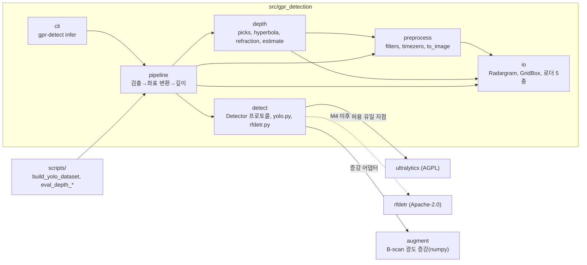
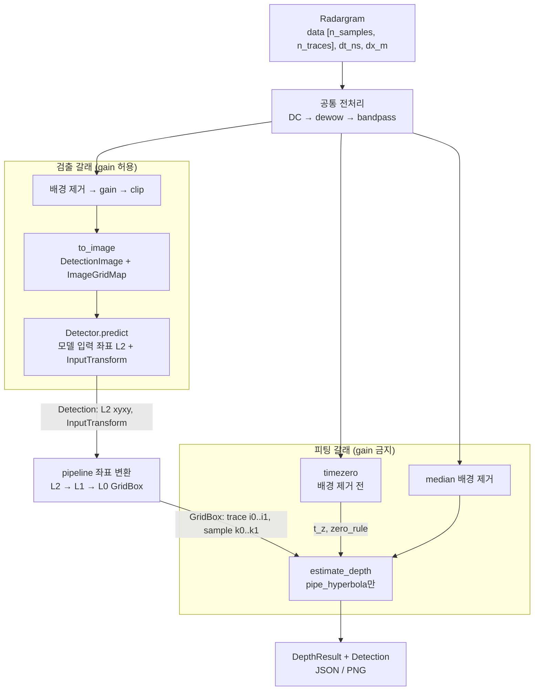

# gpr_detection 아키텍처 개요

- 작성: add-architect (ADD 3.0 design 모드), 2026-10-29 — 체크리스트 M0-12
- 설계 목적: **greenfield**. 2026-10-29 기준 `src/`에는 M1-1·M1-2 구현분(`io/radargram.py`, `io/classes.py`, `io/annotated.py`, `io/paths.py`, `io/_common.py`, 로더 5종 `io/{aihub,morocco,fourtu,guangzhou,gprsd}.py`, `io/_vendor/`, `cli.py` 스텁)만 있다. M1-7·M1-8(2026-10-29)로 §2-3 스케치의 타입(`GridBox`·`PixelBox`·`Detection`·`DetectorOutput`·`InputTransform`·`ImageGridMap`), `pipeline.py` 역변환, `augment.py`가 코드에 들어갔다. 스케치는 구현에 맞춰 고쳤다. 이 문서는 M1–M2 구현 전에 모듈 경계와 두 갈래(검출·깊이)의 좌표 계약을 고정한다.
- 결정 기록: [ADR-001 검출기 이전](ADR-001-detector-migration.md), [ADR-002 물리 기반 깊이](ADR-002-physics-based-depth.md), [ADR-003 데이터 분할·클래스](ADR-003-data-split-and-classes.md), [ADR-004 좌표 계약](ADR-004-coordinate-contract.md)(2026-10-30, §2-3 결정을 옮겨 기록)
- 근거 표기: 사용자·문서가 준 사실은 그대로, 문서에서 추론한 것은 `[추정]`, 이 문서에서 채운 값은 `[가정]`.

## 1. 설계 드라이버

### 1-1. 주요 기능 (FR)

| ID | 기능 | 근거 |
|---|---|---|
| FR-1 | B-scan 영상에서 4개 클래스(`pipe_hyperbola`, `pipe_band`, `cavity`, `manhole`) 박스 검출 | ROADMAP 확정 결정, ADR-003 |
| FR-2 | 물리 스케일(dt_ns, dx_m)이 있는 입력에서 `pipe_hyperbola` 박스마다 관 상단 깊이(m)·불확도·플래그 산출 | CLAUDE.md, spec_depth_v1 §2 |
| FR-3 | 스케일이 없는 입력(AIHub·모로코 JPG)은 꼭짓점 픽셀·시간 위치와 `no_scale`만 산출 | spec_depth_v1 §0-1, §7 순서 1 |
| FR-4 | `gpr-detect infer <파일>` → 박스 + 깊이 JSON/PNG | ROADMAP M5 |
| FR-5 | 검증 경로(검출: AIHub test 홀드아웃 1회 측정 + train_pool 5-fold): gprMax 합성 회귀(R1–R13), 4TU 활동 단위 깊이 검증(13개 현장 전체, 튜닝 없음), 검출 mAP(AIHub 세션 그룹 k-fold) | ROADMAP M1·M2, 사용자 답변 2026-10-29 |

### 1-2. 품질 속성 시나리오 (QA)

| ID | 속성 | 자극원 | 자극 | 대상 | 환경 | 응답 | 응답 척도 | 우선순위 (중요도, 난이도) |
|---|---|---|---|---|---|---|---|---|
| QA-1 | 변경 용이성 (modifiability) | 개발자(python-expert) | YOLO11m을 RF-DETR S/M으로 교체 | `detect/` 와 학습 설정 | M4, 같은 분할·같은 증강 정책 | `Detector` 구현 하나 추가, 설정에서 선택. 이전 판정은 YOLO11m 대비 전체 mAP50 −5 %p 이내(ADR-001) | `detect/`·`configs/` 밖 코드 변경 **0줄**(백엔드 변환이 `InputTransform` 스키마 안에 들 때), `detect/` 밖 `ultralytics` import **0건**(정적 검사), 교체 작업 ≤ 2 인일 `[가정]` | (H, M) |
| QA-2 | 정확성 — 합성 깊이 | 회귀 시험 | gprMax 합성 20개 입력 | `preprocess/`·`depth/` | `pytest -m synthetic`, 시드 0 | 깊이·v·영점 산출 | spec §11-2 기준: R6·R13(M20 공기결합)·R9(지면결합 보정) ≤ 2 cm, R7(공기층 단일 사건 M12·13·15·18) 0 < d−d_top ≤ 5 cm, R8(지면결합 직접파 영점, 얕은 쪽 편향) −5 ≤ d−d_top < 0 cm, R10 ≤ 5 cm·v ±6 %, 실패 0건 | (H, H) |
| QA-3 | 정확성 — 실측 깊이 | 검증 스크립트 | 4TU 13개 현장 활동 | `depth/` + 4TU 로더 | 공기결합, εr 메타 미검증 | 활동 단위 헝가리안 매칭 후 깊이 비교 | MAE(m)와 **공공측량 작업규정 제186조 깊이 ±30 cm 판정률(n/N)** 보고. t0 두 값 × 기준점 상단/중심 두 가정 = 4조합 모두 보고. 깊이 파라미터는 4TU로 튜닝하지 않고 합성에서 정한 기본값으로 13개 현장 전체를 시험에만 쓴다. 목표 판정률은 미정(U-3, M2-8 1차 결과 후 결정) | (H, H) |
| QA-4 | 정확성 — 단위 오용 방지 | 사용자 | 스케일 없는 JPG를 `infer`에 입력 | `depth/estimate`, `pipeline` | 정상 운용 | 깊이 m 값을 내지 않음 | m 단위 깊이 출력 **0건**, 모든 결과 `status="no_scale"`(U7 시험) | (H, L) |
| QA-5 | 재현성 — 누수 방지 | 데이터 빌드 스크립트 | 분할 매니페스트 생성 | `scripts/build_yolo_dataset.py`, `data/splits/` | 빌드 시마다 | 분할 간 그룹 키 교집합 단언 | AIHub 세션(`source`)·gain 제거 크롭 키, 모로코 그룹, 4TU 현장 교집합 **0건**. 위반 시 빌드 실패 | (H, L) |
| QA-6 | 재현성 — 결정성 | 개발자 | 같은 설정·시드로 재실행 | 분할·학습·깊이 | 같은 env 버전 | 같은 결과 | 분할 매니페스트 바이트 동일, 깊이 결과 동일(RANSAC `random_state=0`), 검출 mAP50은 AIHub 세션 그룹 k-fold(기준선 포함, 분할 시드 기록) fold 평균±표준편차로 보고 | (M, M) |
| QA-7 | 라이선스 (license compliance) | 배포 담당 | M5 배포물 생성 | 배포 패키지·가중치 | 배포 전 점검 | AGPL 산출물 배제 | 배포물 안 Ultralytics 코드·YOLO 학습 가중치 **0개**, RF-DETR은 N/S/M/L(Apache-2.0)만 | (H, M) |
| QA-8 | 정확성 — 좌표 계약 | 시험 | 원본 격자 박스 → 검출 이미지 → 원본 격자 왕복 | `preprocess/to_image`, `detect` 래퍼 | 4TU·합성 npy, 비정사각 입력 | 원본 (trace, sample) 복원 | 왕복 오차 ≤ 1 trace·1 sample(사용자 확정 2026-10-30). 바깥쪽 반올림: 격자에 맞춘 박스는 오차 0 왕복, 검출 박스는 각 변 1셀 미만만 넓어짐 | (H, M) |

- 중요도는 사용자 결정 사항(검출기 교체 계획, 제186조 판정, 누수 방지, AGPL 회피)에서 옮겼다. 난이도 H/M/L은 `[가정]`이다.
- 성능(추론 지연·처리량) 시나리오는 드라이버에 없다. 이 프로젝트의 현재 목표는 오프라인 분석이라고 `[추정]`하고 넣지 않았다(§6 백로그).

### 1-3. 제약 (CON)

| ID | 제약 |
|---|---|
| CON-1 | Python 3.13, Windows 11, conda env: `gpr-dev`(ultralytics 8.4.192, torch 2.14.1+cu130), `gpr-detr`(rfdetr 1.11.2, **ultralytics 없음**), `gpr-label` |
| CON-2 | GPU 1장 RTX 4070 SUPER 12 GB, 한 번에 한 계열 GPU 작업 |
| CON-3 | Ultralytics는 AGPL-3.0(학습 산출 모델 포함, 사내 사용도 Enterprise 대상이라고 명시) — `docs/research/packages.md` |
| CON-4 | 원본 데이터 `C:\workspace\GPR_Data`는 읽기 전용. AIHub zip은 풀지 않고 읽는다 |
| CON-5 | AIHub·모로코는 물리 스케일 없음(AIHub permittivity 6.0은 자리채움) |
| CON-6 | 저장소는 공개(GitHub). `data/`·`runs/`는 git 제외 |
| CON-7 | `.py` 구현은 python-expert, 물리 판정은 gpr-processing-expert·electromagnetic-simulation-expert(팀 분업) |

### 1-4. 아키텍처 관심사 (CRN)

| ID | 관심사 |
|---|---|
| CRN-1 | 설정 관리: 깊이 기본값은 `DepthConfig` 하나, 검출은 `configs/train_*.yaml` |
| CRN-2 | 시험 가능성: 앱 없이 모듈 단위 시험(`tests/depth/` U1–U8, R1–R13), `@pytest.mark.synthetic` |
| CRN-3 | 결과 추적: `DepthResult`의 `zero_rule`·`v_rule`·`flags`·`bias_notes`로 어떤 규칙이 쓰였는지 남긴다 |
| CRN-4 | env 분리: 패키지 import가 `gpr-detr`(ultralytics 없음)에서도 성공해야 한다 → `detect/`의 백엔드는 지연 import |

### 1-5. Utility tree

| 품질 속성 | 세부 속성 | 시나리오 |
|---|---|---|
| 정확성 | 합성 깊이 | QA-2 (H, H) |
| | 실측 깊이(제186조) | QA-3 (H, H) |
| | 단위 오용 방지 | QA-4 (H, L) |
| | 좌표 계약 | QA-8 (H, M) |
| 변경 용이성 | 검출기 교체 | QA-1 (H, M) |
| 재현성 | 누수 방지 | QA-5 (H, L) |
| | 결정성 | QA-6 (M, M) |
| 라이선스 | AGPL 배제 | QA-7 (H, M) |

(H, H)인 QA-2·QA-3이 깊이 갈래 구조(ADR-002)를, QA-1·QA-7이 검출 갈래 경계(ADR-001)를, QA-5가 데이터 경로(ADR-003)를 결정한다.

## 2. 최상위 구조 (반복 1 결과)

### 2-1. 설계 개념 선택

| 후보 | 장점 | 단점 | 판정 |
|---|---|---|---|
| **A. 단일 패키지 계층형(모듈러 모놀리스) + 두 갈래 파이프라인** | 단순, 모듈 시험 쉬움, 의존 방향 강제 가능 | 모듈 경계를 규칙(정적 검사)으로 지켜야 함 | **채택** (QA-1, QA-2, CRN-2) |
| B. 검출·깊이를 별도 패키지/서비스로 분리 | 경계가 물리적으로 강제됨 | 오프라인 분석 프로젝트에 배포·버전 관리 부담, 드라이버 없음 | 기각(과잉) |
| C. Ultralytics 파이프라인에 깊이를 콜백으로 붙임 | 코드 적음 | AGPL·Ultralytics API가 깊이 쪽까지 퍼져 QA-1·QA-7 위반 | 기각 |

### 2-2. 모듈 뷰



화살표는 "import한다"이다. 검증: Mermaid Chart 검증 도구 통과(2026-10-29).

| 모듈 | 책임 | 드라이버 |
|---|---|---|
| `io` | `Radargram`(spec §1-1)과 데이터셋별 로더, 원본 격자 박스 `GridBox`. 메타 t0 샘플 → ns 변환. 스케일 없는 입력은 `dt_ns=None` | FR-2, FR-3, QA-4, CON-4 |
| `preprocess` | `filters`(DC·dewow·bandpass·median 배경 제거·AGC), `timezero`(영점 사건 검출·선택), `to_image`(검출 갈래 영상화와 `ImageGridMap`) | QA-2, QA-8 |
| `detect` | `Detector` 프로토콜, 백엔드 래퍼(`yolo.py`, M4에 `rfdetr.py`), 증강 어댑터(`yolo_train.py`, 증강 본체는 최상위 `augment.py`). **ultralytics·rfdetr import는 여기에만** | QA-1, QA-7, CRN-4 |
| `augment` | 백엔드 공통 B-scan 광도 증강 4종(가우시안 잡음·대비/감마·수평 띠 잡음·트레이스 누락). numpy만 사용(torch·cv2·ultralytics·rfdetr 금지) | QA-1, M1-7 |
| `depth` | 점 추출·RANSAC·least_squares(R 고정)·굴절 모델·v 결정표·불확도 → `DepthResult` | FR-2, QA-2, QA-3 |
| `pipeline` | 두 갈래를 조립하고 클래스 필터(깊이는 `pipe_hyperbola`만)와 좌표 변환을 적용 | FR-4, QA-8 |
| `cli` | `gpr-detect infer` | FR-4 |
| `scripts/` | 데이터 빌드·평가 진입점. 패키지를 import하고 **패키지는 `scripts/`를 import하지 않는다** | QA-5, FR-5 |

의존 규칙(정적 검사로 시험한다, CRN-2):
1. `detect`와 `depth`는 서로 import하지 않는다. 둘을 만나게 하는 곳은 `pipeline`뿐이다.
2. `io`는 패키지 안 다른 모듈을 import하지 않는다.
3. `ultralytics`·`rfdetr` import는 `src/gpr_detection/detect/` 아래 백엔드 파일에만, 함수 안 지연 import로 둔다(`gpr-detr` env에 ultralytics가 없다, CON-1).
4. `src/`는 `scripts/`를 import하지 않는다(spec §6-1: `ray_geometry` 알고리즘은 `depth/refraction.py`로 옮겨 구현).
5. `augment`는 torch·cv2·ultralytics·rfdetr를 import하지 않는다(시험: `tests/test_architecture_rules.py`). `detect` → `augment` 의존은 허용(어댑터).

### 2-3. 두 갈래 데이터 흐름과 좌표 계약



검증: Mermaid Chart 검증 도구 통과(2026-10-29). 갈래 분리 근거는 spec_depth_v1 §3(피팅은 gain 없는 시간축, 영점은 배경 제거 전).

좌표는 세 층이다. 각 층의 소유자와 변환 책임을 고정한다. **좌표 역변환(L2 → L1 → L0)은 `pipeline`이 한 곳에서 공통으로 한다**(사용자 결정 2026-10-29). 대안·트레이드오프·반올림 규칙 비교는 [ADR-004](ADR-004-coordinate-contract.md)에 있다.

| 층 | 좌표 | 정의 위치 | 다음 층으로의 변환 책임 |
|---|---|---|---|
| L0 원본 격자 | (trace `i`, sample `k`), 정수 인덱스, `data[k, i]` | `io` (`Radargram`, `GridBox`) | — (깊이는 이 층만 받는다, spec §1-2) |
| L1 검출 이미지 | 검출 입력 영상의 픽셀 (u, v), 리사이즈·타일 후, **letterbox 전** | `preprocess/to_image` (`DetectionImage`, `ImageGridMap`) | `pipeline`이 `ImageGridMap`으로 L1 → L0 |
| L2 모델 입력 | letterbox·정사각 리사이즈 후 텐서 좌표 | 각 `Detector` 백엔드가 만들고 `InputTransform`으로 공개 | `pipeline`이 `InputTransform`으로 L2 → L1 |

인터페이스(시그니처는 계약 설명용 스케치):

```python
class Detector(Protocol):
    class_names: tuple[str, ...]          # ("pipe_hyperbola", "pipe_band", "cavity", "manhole")
    def predict(self, image: np.ndarray) -> DetectorOutput: ...   # image: L1, uint8 [H, W] 또는 [H, W, 3]

@dataclass(frozen=True)
class InputTransform:     # detect/base.py — 백엔드가 L1 → L2에 적용한 변환
    scale_x: float; scale_y: float   # L2 px / L1 px, 축별(정사각 늘림이면 서로 다름)
    pad_x: float; pad_y: float       # L2에서 왼쪽·위쪽 패딩(px)
    input_w: int; input_h: int       # L2 크기(검증용)

@dataclass(frozen=True)
class PixelBox:           # detect/base.py — 연속 픽셀 좌표(픽셀 j는 [j, j+1))
    x1: float; y1: float; x2: float; y2: float

@dataclass(frozen=True)
class Detection:          # detect/base.py
    class_id: int; class_name: str; score: float
    box: PixelBox                                # L2 픽셀(모델 입력 좌표 그대로)

@dataclass(frozen=True)
class DetectorOutput:
    detections: tuple[Detection, ...]
    transform: InputTransform

@dataclass(frozen=True)
class ImageGridMap:       # preprocess/to_image.py
    trace_offset: int; sample_offset: int        # 타일 원점(L0)
    traces_per_px: float; samples_per_px: float  # 리사이즈 배율
    n_traces: int; n_samples: int                # 격자 크기(자르기용)
    # pipeline: u = (x − pad_x) / scale_x  (L2→L1),  i = trace_offset + u · traces_per_px  (L1→L0)
    #           셀 j는 [j, j+1). 박스 [t1,t2]는 닫힌 인덱스 floor(t1+1e-6) .. ceil(t2−1e-6)−1,
    #           영폭은 1셀, 격자 범위로 자르고 격자 밖이면 버린다(None). 이 규칙은 pipeline.py 한 곳에만 둔다

@dataclass(frozen=True)
class GridBox:            # io/radargram.py
    i0: int; i1: int; k0: int; k1: int           # 닫힌 구간, L0
```

계약 규칙:
- `Detector.predict`는 박스를 **L2(모델 입력) 좌표 그대로** 돌려주고, 자기가 적용한 L1 → L2 변환을 `InputTransform`으로 함께 낸다. letterbox(Ultralytics)든 정사각 리사이즈(RF-DETR `square_resize_div_64`)든 역변환은 백엔드가 하지 않는다.
- `pipeline`은 L2 → L1(`InputTransform`) → L0(`ImageGridMap`)를 한 함수에서 처리한다. 좌표 변환 코드가 한 곳뿐이라 QA-8 왕복 시험도 이 함수 하나만 보면 된다.
- 트레이드오프:
  - 얻는 것: 역변환이 한 곳에 있어 백엔드마다 따로 구현하다 생기는 오차가 없다. 백엔드 래퍼가 얇아진다.
  - 잃는 것: 백엔드가 전처리 파라미터(배율·패딩)를 `InputTransform`으로 정확히 노출해야 한다. Ultralytics의 내부 letterbox 값(`ratio_pad`)처럼 라이브러리가 감추는 값을 래퍼가 꺼내야 한다.
  - 위험: 새 백엔드의 전처리가 "축별 배율 + 패딩"으로 표현되지 않으면(크롭, 타일링, 비선형 리사이즈 등) `InputTransform` 스키마와 `pipeline`을 함께 고쳐야 한다. 이때는 QA-1의 "`detect/` 밖 변경 0줄"이 깨진다. 대응: 백엔드 래퍼 시험에 "알려진 박스를 L1 → L2 → L1 왕복해서 오차 ≤ 0.5 px"를 넣는다(M1-8, M4-4).
- 세로축은 항상 시간 증가 방향이 아래다. 상하 반전은 어느 층에서도 없다(augmentation_policy §1).
- `ImageGridMap`은 등방 여부와 무관하게 축별 배율을 따로 가진다(4TU 512×N 측선은 가로세로 배율이 다를 수 있음).
- 스케일 없는 입력(AIHub·모로코)도 L0가 정의된다(이미지 픽셀 = 격자). `dt_ns=None`이라 깊이는 `no_scale`(QA-4). 라벨 박스 `io/annotated.py`의 `Box`(원본 이미지 px)는 이 경우 L0 좌표다.
- `GridBox`는 `io/radargram.py`에 구현됨(M1-8, 닫힌 구간 `i0..i1`·`k0..k1`). `detect`·`depth`가 서로 import하지 않고 같은 타입을 쓴다.
- `depth`는 `Detection`을 모른다. `pipeline`이 `class_name == "pipe_hyperbola"`인 것만 `GridBox`로 바꿔 넘긴다(ADR-002·ADR-003). `pipe_band` 깊이는 M2-6 명세 뒤에 같은 계약으로 추가한다.

## 3. 결정 요약

| ADR | 결정 | 드라이버 | 상태 |
|---|---|---|---|
| [ADR-001](ADR-001-detector-migration.md) | YOLO11m 초안 → RF-DETR S/M 이전, `Detector` 프로토콜 뒤로 격리 | QA-1, QA-7, CON-1, CON-3 | Accepted 2026-10-29 |
| [ADR-002](ADR-002-physics-based-depth.md) | 물리 기반 쌍곡선 피팅, 공기결합은 지표 반사 영점·v 고정, R 고정, 스케일 없으면 m 금지 | QA-2, QA-3, QA-4, FR-2, FR-3 | Accepted 2026-10-29 |
| [ADR-003](ADR-003-data-split-and-classes.md) | 클래스 4개, 그룹 키 단위 분할(AIHub 세션·크롭 키, 모로코 그룹, 4TU 현장), 기준점 두 가정 보고 | QA-5, QA-6, QA-3, FR-1 | Accepted 2026-10-29 |
| [ADR-004](ADR-004-coordinate-contract.md) | 3층 좌표 계약(L0·L1·L2), 역변환은 pipeline 공통, 바깥쪽 반올림 | QA-8, QA-1, FR-2, FR-3, QA-4, CRN-2, CRN-4 | Accepted 2026-10-30(결정 2026-10-29) |
| (이 문서) | 단일 패키지 계층형 + 두 갈래 | QA-1, CRN-2, CRN-4 | 확정 2026-10-29 |

## 4. 분석 (반복 1, ADD ⑦단계)

| 드라이버 | 판정 | 근거·남은 일 |
|---|---|---|
| QA-1 | 부분 해결 | 구조(§2-2 규칙 1·3, `InputTransform` 스키마로 백엔드 변환을 표준화)로 대응. M1-8 정적 검사와 M4-4 실제 교체로 확인. 이전 판정 기준은 전체 mAP50 −5 %p 이내 |
| QA-2 | 부분 해결 | 알고리즘·허용치는 spec_depth_v1에 확정. 구현(M2-1–M2-5) 후 시험으로 판정 — **측정으로 검증** |
| QA-3 | 부분 해결 | 보고 형식(4조합)과 "4TU 튜닝 없음·13개 현장 전체 시험" 확정, 목표 판정률 미정(U-3). M2-8 |
| QA-4 | 부분 해결 | 규칙 확정(spec §7 순서 1, U7). 구현 후 시험 |
| QA-5 | 부분 해결 | 그룹 키 정의 확정(ADR-003). M1-3·M1-5 단언으로 확인 |
| QA-6 | 부분 해결 | 시드 규약과 AIHub test 세션 홀드아웃 + train_pool 세션 그룹 5-fold(기준선 포함) 확정. 학습 비용 약 5배(ADR-003) |
| QA-7 | 부분 해결 | 격리 경계 확정. M4 이전·M5-4 배포 점검 전까지 리스크 유지(U-4) |
| QA-8 | 부분 해결 | 3층 계약 정의(ADR-004). M1-8 합성 왕복 시험 있음(L0 정확 왕복, L1↔L2 ≤ 0.5 px). M3-1 실측 경로 왕복 시험 남음. 허용 오차 ≤ 1 trace·1 sample 확정(2026-10-30) |

리스크:
- R-A: pipe 독립 세션이 lpipe 13·tpipe 11개뿐이고 전부 NM 장비 → 분할 분산·장비 편향(ADR-003).
- R-B: 4TU `eps_r_used`가 곡률 피팅값이면 깊이가 한쪽으로 깊게 편향(spec §9) → `meta_eps_unverified`·`refraction_qc`.
- R-C: RF-DETR 기본 정사각 리사이즈 → 쌍곡선 왜곡과 비교 불공정(M4-1에서 비율 유지 경로 확인).
- R-D: 공개 저장소에 YOLO 가중치가 실수로 올라가면 AGPL 산출물이 공개된다. 대응: `.gitignore`(`*.pt`, `*.onnx`, `/runs/`, `/data/`)와 커밋 전 비밀·데이터 점검(CLAUDE.md 작업 운영). 별도 규칙은 추가하지 않는다(사용자 결정 2026-10-29).
- R-E: test 홀드아웃 뒤 train_pool 5-fold 전면 적용으로 검출 학습 비용이 약 5배다(GPU 1장, CON-2). 30분 넘는 학습은 long-running-task-monitor 규칙을 따른다.

## 5. 확인 질문과 답 (2026-10-29 사용자 답변 반영)

| 질문 | 답 | 반영 위치 |
|---|---|---|
| Q1 RF-DETR "이전 가능" 판정 기준 | YOLO11m 대비 **전체 mAP50 −5 %p 이내** | ADR-001 결정 4·후속 과제, QA-1 |
| Q2 좌표 역변환 책임 위치 | **pipeline 공통 처리**(백엔드는 L2 좌표 + `InputTransform` 반환) | §2-3 계약, ADR-001 결정 3 |
| Q3 YOLO 가중치 반출 금지 규칙 | **`.gitignore`로 충분**, CLAUDE.md 규칙 추가 안 함 | §4 R-D, ADR-001 위험 |
| Q4 AIHub 분할 방식 | **test 세션 홀드아웃 + train_pool 세션 그룹 5-fold**(기준선 포함, 2026-10-29 개정) | ADR-003 결정 2·6, QA-6 |
| Q5 4TU 깊이 파라미터 튜닝 | **튜닝 안 함**, 합성 기본값으로 13개 현장 전체 시험 | ADR-003 결정 4, QA-3 |

## 6. 설계 백로그

| 드라이버 | 상태 | 다음 반복 |
|---|---|---|
| FR-1, QA-1, QA-7 | 부분 해결 | 반복 2(M1-8 `Detector` 구현 검토), 반복 4(M4 이전) |
| FR-2, FR-3, QA-2, QA-3, QA-4 | 부분 해결 | 반복 3(M2 구현 결과로 판정) |
| QA-5, QA-6 | 부분 해결 | 반복 2(M1-3 매니페스트 검토) |
| QA-8 | 부분 해결(ADR-004) | 반복 3(M3-1 좌표 시험) |
| FR-4, FR-5 | 미착수 | 반복 5(M5 통합) |
| CRN-1–CRN-4 | 부분 해결 | 반복 2 |
| 성능(추론 지연) | 드라이버 없음 | M5 전에 필요 여부 확인 |

반복 로드맵: 1회차(이 문서) 최상위 구조·좌표 계약·ADR 3건 → 2회차 M1 산출물(io·detect·분할) 검토 → 3회차 M2·M3-1(깊이·좌표 계약) 검토 → 4회차 M4 이전 결과로 ADR-001 갱신(M4-5) → 5회차 M5 배포·라이선스.
