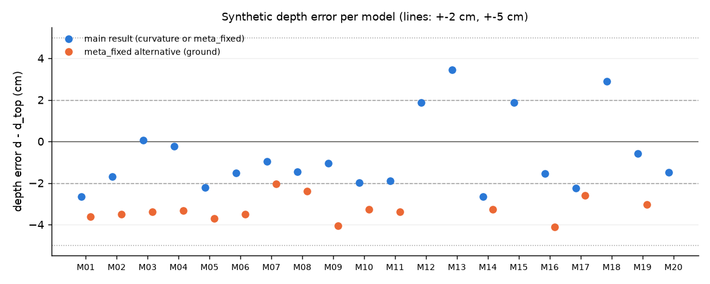
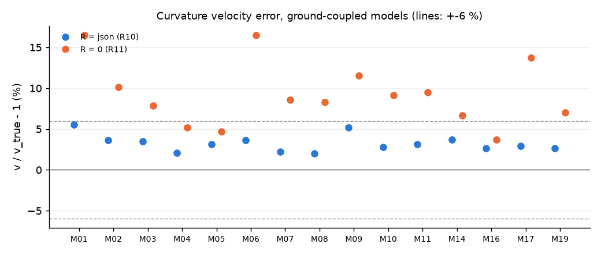

# gprMax 합성 깊이 회귀 v1 (M2-5)

- 생성: `scripts/eval_depth_synthetic.py`, 2026-10-30T22:27:37+09:00, commit 9048be7fbb0ce8c97337c134f44f13769a74e916 (dirty True)
- 명세: `docs/processing/spec_depth_v1.md` §11-2 (R1-R13, 박스 공급 규칙)
- 실행 시간: 전체 92.3 s, 모델별 0.4-68.3 s (단일 프로세스)
- 판정 등급: match ≤5 %·2 cm, acceptable match d ≤10 cm (공기결합은 d만)

## R1-R13 판정

| check | criterion | passed | verdict | failed models |
|---|---|---|---|---|
| R1 | \|dt\| <= 0.05 ns | 15/15 | PASS | - |
| R4 | \|di\| <= 3 | 20/20 | PASS | - |
| R5 | \|t_seed - t_ideal(D-bg, (1)-(3))\| <= 0.05 ns | 20/20 | PASS | - |
| R8 | -5 <= dd < 0 cm (meta_fixed, ground_direct_peak) | 15/15 | PASS | - |
| R9 | \|dd\| <= 2 cm (meta_fixed, ground_direct_shifted) | 15/15 | PASS | - |
| R10 | \|dv\| <= 6 %, \|dd\| <= 5 cm (curvature_R_fixed) | 15/15 | PASS | - |
| R11 | v'/v > 1 (R = 0 curvature) | 15/15 | PASS | - |
| R3 | air_single_event, \|dt\| <= 0.05 ns | 4/4 | PASS | - |
| R7 | 0 < dd <= 5 cm (meta_fixed) | 4/4 | PASS | - |
| R2 | 2 events, \|dt\| <= 0.35 ns, \|dh\| <= 0.07 m | 1/1 | PASS | - |
| R6 | \|dd\| <= 2 cm (meta_fixed) | 1/1 | PASS | - |
| R12 | straight-ray curvature request raises ValueError | 1/1 | PASS | - |
| R13a-1 | json ray picks, json h/s/R: eps +- 0.1, \|dd\| <= 1 cm | 1/1 | PASS | - |
| R13a-2 | measured picks, json h/s/R: \|eps/eps_true - 1\| <= 20 %, \|dd\| <= 5 cm | 1/1 | PASS | - |
| R13b | h_est path: range contains 9, no meta_eps_suspect | 1/1 | PASS | - |

## 모델별 결과

| model_id | pipe_material | air_gap_m | eps_r | d_true_m | d_est_m | d_err_cm | grade | status | v_rule | v_err_pct | zero_rule | flags |
|---|---|---|---|---|---|---|---|---|---|---|---|---|
| M01 | pec | 0.0 | 9.0 | 0.3 | 0.2735 | -2.65 | acceptable match | ok | curvature_R_fixed | 5.53 | ground_direct_peak |  |
| M02 | pec | 0.0 | 9.0 | 0.6 | 0.5832 | -1.68 | match | ok | curvature_R_fixed | 3.63 | ground_direct_peak |  |
| M03 | pec | 0.0 | 9.0 | 1.0 | 1.0005 | 0.05 | match | ok | curvature_R_fixed | 3.51 | ground_direct_peak |  |
| M04 | pec | 0.0 | 9.0 | 1.5 | 1.4977 | -0.23 | match | ok | curvature_R_fixed | 2.08 | ground_direct_peak |  |
| M05 | pec | 0.0 | 9.0 | 0.6 | 0.5778 | -2.22 | acceptable match | ok | curvature_R_fixed | 3.11 | ground_direct_peak |  |
| M06 | pec | 0.0 | 9.0 | 0.6 | 0.5848 | -1.52 | match | ok | curvature_R_fixed | 3.67 | ground_direct_peak |  |
| M07 | pvc_air | 0.0 | 9.0 | 0.6 | 0.5904 | -0.96 | match | ok | curvature_R_fixed | 2.25 | ground_direct_peak |  |
| M08 | pvc_water | 0.0 | 9.0 | 0.6 | 0.5854 | -1.46 | match | ok | curvature_R_fixed | 1.98 | ground_direct_peak |  |
| M09 | pec | 0.0 | 4.0 | 0.6 | 0.5895 | -1.05 | acceptable match | ok | curvature_R_fixed | 5.22 | ground_direct_peak |  |
| M10 | pec | 0.0 | 16.0 | 0.6 | 0.5802 | -1.98 | match | ok | curvature_R_fixed | 2.79 | ground_direct_peak |  |
| M11 | pec | 0.0 | 9.0 | 0.6 | 0.5812 | -1.88 | match | ok | curvature_R_fixed | 3.11 | ground_direct_peak |  |
| M12 | pec | 0.1 | 9.0 | 0.6 | 0.6187 | 1.87 | match | ok | meta_fixed | -0.0 | air_single_event | meta_eps_unverified |
| M13 | pvc_air | 0.1 | 4.0 | 1.0 | 1.0345 | 3.45 | acceptable match | ok | meta_fixed | -0.0 | air_single_event | meta_eps_unverified |
| M14 | pvc_water | 0.0 | 16.0 | 0.3 | 0.2733 | -2.67 | acceptable match | ok | curvature_R_fixed | 3.69 | ground_direct_peak |  |
| M15 | pec | 0.1 | 16.0 | 1.5 | 1.5188 | 1.88 | match | ok | meta_fixed | -0.0 | air_single_event | meta_eps_unverified |
| M16 | pec | 0.0 | 4.0 | 1.0 | 0.9846 | -1.54 | match | ok | curvature_R_fixed | 2.64 | ground_direct_peak |  |
| M17 | pvc_air | 0.0 | 16.0 | 0.3 | 0.2776 | -2.24 | acceptable match | ok | curvature_R_fixed | 2.9 | ground_direct_peak |  |
| M18 | pvc_water | 0.1 | 9.0 | 1.0 | 1.0289 | 2.89 | acceptable match | ok | meta_fixed | -0.0 | air_single_event | meta_eps_unverified |
| M19 | pec | 0.0 | 16.0 | 1.0 | 0.9941 | -0.59 | match | ok | curvature_R_fixed | 2.62 | ground_direct_peak |  |
| M20 | pec | 0.3 | 9.0 | 0.6 | 0.5851 | -1.49 | match | ok | meta_fixed | -0.0 | air_surface_late | meta_eps_unverified |

## 검사별 측정값

| check | model_id | measured | criterion | passed | grade |
|---|---|---|---|---|---|
| R1 | M01 | -0.000 ns | \|dt\| <= 0.05 ns | True |  |
| R4 | M01 | +0 traces | \|di\| <= 3 | True |  |
| R5 | M01 | +0.002 ns | \|t_seed - t_ideal(D-bg, (1)-(3))\| <= 0.05 ns | True |  |
| R8 | M01 | -3.633 cm | -5 <= dd < 0 cm (meta_fixed, ground_direct_peak) | True |  |
| R9 | M01 | ground_direct_shifted, +0.047 cm | \|dd\| <= 2 cm (meta_fixed, ground_direct_shifted) | True |  |
| R10 | M01 | curvature_R_fixed, v +5.534 %, d -2.646 cm | \|dv\| <= 6 %, \|dd\| <= 5 cm (curvature_R_fixed) | True | acceptable match |
| R11 | M01 | curvature_R_fixed, v'/v - 1 +16.515 % | v'/v > 1 (R = 0 curvature) | True |  |
| R1 | M02 | -0.001 ns | \|dt\| <= 0.05 ns | True |  |
| R4 | M02 | +0 traces | \|di\| <= 3 | True |  |
| R5 | M02 | +0.005 ns | \|t_seed - t_ideal(D-bg, (1)-(3))\| <= 0.05 ns | True |  |
| R8 | M02 | -3.513 cm | -5 <= dd < 0 cm (meta_fixed, ground_direct_peak) | True |  |
| R9 | M02 | ground_direct_shifted, +0.123 cm | \|dd\| <= 2 cm (meta_fixed, ground_direct_shifted) | True |  |
| R10 | M02 | curvature_R_fixed, v +3.626 %, d -1.680 cm | \|dv\| <= 6 %, \|dd\| <= 5 cm (curvature_R_fixed) | True | match |
| R11 | M02 | curvature_R_fixed, v'/v - 1 +10.112 % | v'/v > 1 (R = 0 curvature) | True |  |
| R1 | M03 | -0.001 ns | \|dt\| <= 0.05 ns | True |  |
| R4 | M03 | +0 traces | \|di\| <= 3 | True |  |
| R5 | M03 | +0.010 ns | \|t_seed - t_ideal(D-bg, (1)-(3))\| <= 0.05 ns | True |  |
| R8 | M03 | -3.386 cm | -5 <= dd < 0 cm (meta_fixed, ground_direct_peak) | True |  |
| R9 | M03 | ground_direct_shifted, +0.241 cm | \|dd\| <= 2 cm (meta_fixed, ground_direct_shifted) | True |  |
| R10 | M03 | curvature_R_fixed, v +3.513 %, d +0.053 cm | \|dv\| <= 6 %, \|dd\| <= 5 cm (curvature_R_fixed) | True | match |
| R11 | M03 | curvature_R_fixed, v'/v - 1 +7.888 % | v'/v > 1 (R = 0 curvature) | True |  |
| R1 | M04 | -0.001 ns | \|dt\| <= 0.05 ns | True |  |
| R4 | M04 | +0 traces | \|di\| <= 3 | True |  |
| R5 | M04 | -0.007 ns | \|t_seed - t_ideal(D-bg, (1)-(3))\| <= 0.05 ns | True |  |
| R8 | M04 | -3.317 cm | -5 <= dd < 0 cm (meta_fixed, ground_direct_peak) | True |  |
| R9 | M04 | ground_direct_shifted, +0.308 cm | \|dd\| <= 2 cm (meta_fixed, ground_direct_shifted) | True |  |
| R10 | M04 | curvature_R_fixed, v +2.078 %, d -0.226 cm | \|dv\| <= 6 %, \|dd\| <= 5 cm (curvature_R_fixed) | True | match |
| R11 | M04 | curvature_R_fixed, v'/v - 1 +5.187 % | v'/v > 1 (R = 0 curvature) | True |  |
| R1 | M05 | -0.001 ns | \|dt\| <= 0.05 ns | True |  |
| R4 | M05 | +0 traces | \|di\| <= 3 | True |  |
| R5 | M05 | +0.006 ns | \|t_seed - t_ideal(D-bg, (1)-(3))\| <= 0.05 ns | True |  |
| R8 | M05 | -3.705 cm | -5 <= dd < 0 cm (meta_fixed, ground_direct_peak) | True |  |
| R9 | M05 | ground_direct_shifted, -0.070 cm | \|dd\| <= 2 cm (meta_fixed, ground_direct_shifted) | True |  |
| R10 | M05 | curvature_R_fixed, v +3.107 %, d -2.220 cm | \|dv\| <= 6 %, \|dd\| <= 5 cm (curvature_R_fixed) | True | acceptable match |
| R11 | M05 | curvature_R_fixed, v'/v - 1 +4.714 % | v'/v > 1 (R = 0 curvature) | True |  |
| R1 | M06 | -0.001 ns | \|dt\| <= 0.05 ns | True |  |
| R4 | M06 | +0 traces | \|di\| <= 3 | True |  |
| R5 | M06 | +0.006 ns | \|t_seed - t_ideal(D-bg, (1)-(3))\| <= 0.05 ns | True |  |
| R8 | M06 | -3.490 cm | -5 <= dd < 0 cm (meta_fixed, ground_direct_peak) | True |  |
| R9 | M06 | ground_direct_shifted, +0.145 cm | \|dd\| <= 2 cm (meta_fixed, ground_direct_shifted) | True |  |
| R10 | M06 | curvature_R_fixed, v +3.666 %, d -1.520 cm | \|dv\| <= 6 %, \|dd\| <= 5 cm (curvature_R_fixed) | True | match |
| R11 | M06 | curvature_R_fixed, v'/v - 1 +16.498 % | v'/v > 1 (R = 0 curvature) | True |  |
| R1 | M07 | -0.001 ns | \|dt\| <= 0.05 ns | True |  |
| R4 | M07 | +0 traces | \|di\| <= 3 | True |  |
| R5 | M07 | -0.018 ns | \|t_seed - t_ideal(D-bg, (1)-(3))\| <= 0.05 ns | True |  |
| R8 | M07 | -2.037 cm | -5 <= dd < 0 cm (meta_fixed, ground_direct_peak) | True |  |
| R9 | M07 | ground_direct_shifted, +1.598 cm | \|dd\| <= 2 cm (meta_fixed, ground_direct_shifted) | True |  |
| R10 | M07 | curvature_R_fixed, v +2.247 %, d -0.963 cm | \|dv\| <= 6 %, \|dd\| <= 5 cm (curvature_R_fixed) | True | match |
| R11 | M07 | curvature_R_fixed, v'/v - 1 +8.584 % | v'/v > 1 (R = 0 curvature) | True |  |
| R1 | M08 | -0.001 ns | \|dt\| <= 0.05 ns | True |  |
| R4 | M08 | +0 traces | \|di\| <= 3 | True |  |
| R5 | M08 | +0.014 ns | \|t_seed - t_ideal(D-bg, (1)-(3))\| <= 0.05 ns | True |  |
| R8 | M08 | -2.387 cm | -5 <= dd < 0 cm (meta_fixed, ground_direct_peak) | True |  |
| R9 | M08 | ground_direct_shifted, +1.248 cm | \|dd\| <= 2 cm (meta_fixed, ground_direct_shifted) | True |  |
| R10 | M08 | curvature_R_fixed, v +1.985 %, d -1.460 cm | \|dv\| <= 6 %, \|dd\| <= 5 cm (curvature_R_fixed) | True | match |
| R11 | M08 | curvature_R_fixed, v'/v - 1 +8.299 % | v'/v > 1 (R = 0 curvature) | True |  |
| R1 | M09 | +0.003 ns | \|dt\| <= 0.05 ns | True |  |
| R4 | M09 | +0 traces | \|di\| <= 3 | True |  |
| R5 | M09 | +0.007 ns | \|t_seed - t_ideal(D-bg, (1)-(3))\| <= 0.05 ns | True |  |
| R8 | M09 | -4.069 cm | -5 <= dd < 0 cm (meta_fixed, ground_direct_peak) | True |  |
| R9 | M09 | ground_direct_shifted, -0.082 cm | \|dd\| <= 2 cm (meta_fixed, ground_direct_shifted) | True |  |
| R10 | M09 | curvature_R_fixed, v +5.219 %, d -1.045 cm | \|dv\| <= 6 %, \|dd\| <= 5 cm (curvature_R_fixed) | True | acceptable match |
| R11 | M09 | curvature_R_fixed, v'/v - 1 +11.573 % | v'/v > 1 (R = 0 curvature) | True |  |
| R1 | M10 | -0.015 ns | \|dt\| <= 0.05 ns | True |  |
| R4 | M10 | +0 traces | \|di\| <= 3 | True |  |
| R5 | M10 | -0.001 ns | \|t_seed - t_ideal(D-bg, (1)-(3))\| <= 0.05 ns | True |  |
| R8 | M10 | -3.265 cm | -5 <= dd < 0 cm (meta_fixed, ground_direct_peak) | True |  |
| R9 | M10 | ground_direct_shifted, +0.345 cm | \|dd\| <= 2 cm (meta_fixed, ground_direct_shifted) | True |  |
| R10 | M10 | curvature_R_fixed, v +2.789 %, d -1.982 cm | \|dv\| <= 6 %, \|dd\| <= 5 cm (curvature_R_fixed) | True | match |
| R11 | M10 | curvature_R_fixed, v'/v - 1 +9.139 % | v'/v > 1 (R = 0 curvature) | True |  |
| R1 | M11 | -0.004 ns | \|dt\| <= 0.05 ns | True |  |
| R4 | M11 | +0 traces | \|di\| <= 3 | True |  |
| R5 | M11 | +0.008 ns | \|t_seed - t_ideal(D-bg, (1)-(3))\| <= 0.05 ns | True |  |
| R8 | M11 | -3.377 cm | -5 <= dd < 0 cm (meta_fixed, ground_direct_peak) | True |  |
| R9 | M11 | ground_direct_shifted, +0.269 cm | \|dd\| <= 2 cm (meta_fixed, ground_direct_shifted) | True |  |
| R10 | M11 | curvature_R_fixed, v +3.108 %, d -1.885 cm | \|dv\| <= 6 %, \|dd\| <= 5 cm (curvature_R_fixed) | True | match |
| R11 | M11 | curvature_R_fixed, v'/v - 1 +9.500 % | v'/v > 1 (R = 0 curvature) | True |  |
| R3 | M12 | air_single_event, -0.019 ns | air_single_event, \|dt\| <= 0.05 ns | True |  |
| R4 | M12 | +0 traces | \|di\| <= 3 | True |  |
| R5 | M12 | +0.008 ns | \|t_seed - t_ideal(D-bg, (1)-(3))\| <= 0.05 ns | True |  |
| R7 | M12 | meta_fixed, +1.867 cm | 0 < dd <= 5 cm (meta_fixed) | True | match |
| R3 | M13 | air_single_event, -0.012 ns | air_single_event, \|dt\| <= 0.05 ns | True |  |
| R4 | M13 | +0 traces | \|di\| <= 3 | True |  |
| R5 | M13 | -0.019 ns | \|t_seed - t_ideal(D-bg, (1)-(3))\| <= 0.05 ns | True |  |
| R7 | M13 | meta_fixed, +3.449 cm | 0 < dd <= 5 cm (meta_fixed) | True | acceptable match |
| R1 | M14 | -0.046 ns | \|dt\| <= 0.05 ns | True |  |
| R4 | M14 | +0 traces | \|di\| <= 3 | True |  |
| R5 | M14 | +0.000 ns | \|t_seed - t_ideal(D-bg, (1)-(3))\| <= 0.05 ns | True |  |
| R8 | M14 | -3.267 cm | -5 <= dd < 0 cm (meta_fixed, ground_direct_peak) | True |  |
| R9 | M14 | ground_direct_shifted, +0.651 cm | \|dd\| <= 2 cm (meta_fixed, ground_direct_shifted) | True |  |
| R10 | M14 | curvature_R_fixed, v +3.691 %, d -2.670 cm | \|dv\| <= 6 %, \|dd\| <= 5 cm (curvature_R_fixed) | True | acceptable match |
| R11 | M14 | curvature_R_fixed, v'/v - 1 +6.641 % | v'/v > 1 (R = 0 curvature) | True |  |
| R3 | M15 | air_single_event, -0.018 ns | air_single_event, \|dt\| <= 0.05 ns | True |  |
| R4 | M15 | +0 traces | \|di\| <= 3 | True |  |
| R5 | M15 | -0.006 ns | \|t_seed - t_ideal(D-bg, (1)-(3))\| <= 0.05 ns | True |  |
| R7 | M15 | meta_fixed, +1.882 cm | 0 < dd <= 5 cm (meta_fixed) | True | match |
| R1 | M16 | +0.001 ns | \|dt\| <= 0.05 ns | True |  |
| R4 | M16 | +0 traces | \|di\| <= 3 | True |  |
| R5 | M16 | +0.006 ns | \|t_seed - t_ideal(D-bg, (1)-(3))\| <= 0.05 ns | True |  |
| R8 | M16 | -4.113 cm | -5 <= dd < 0 cm (meta_fixed, ground_direct_peak) | True |  |
| R9 | M16 | ground_direct_shifted, -0.136 cm | \|dd\| <= 2 cm (meta_fixed, ground_direct_shifted) | True |  |
| R10 | M16 | curvature_R_fixed, v +2.636 %, d -1.541 cm | \|dv\| <= 6 %, \|dd\| <= 5 cm (curvature_R_fixed) | True | match |
| R11 | M16 | curvature_R_fixed, v'/v - 1 +3.741 % | v'/v > 1 (R = 0 curvature) | True |  |
| R1 | M17 | -0.015 ns | \|dt\| <= 0.05 ns | True |  |
| R4 | M17 | +0 traces | \|di\| <= 3 | True |  |
| R5 | M17 | +0.000 ns | \|t_seed - t_ideal(D-bg, (1)-(3))\| <= 0.05 ns | True |  |
| R8 | M17 | -2.590 cm | -5 <= dd < 0 cm (meta_fixed, ground_direct_peak) | True |  |
| R9 | M17 | ground_direct_shifted, +1.060 cm | \|dd\| <= 2 cm (meta_fixed, ground_direct_shifted) | True |  |
| R10 | M17 | curvature_R_fixed, v +2.903 %, d -2.245 cm | \|dv\| <= 6 %, \|dd\| <= 5 cm (curvature_R_fixed) | True | acceptable match |
| R11 | M17 | curvature_R_fixed, v'/v - 1 +13.712 % | v'/v > 1 (R = 0 curvature) | True |  |
| R3 | M18 | air_single_event, -0.019 ns | air_single_event, \|dt\| <= 0.05 ns | True |  |
| R4 | M18 | +0 traces | \|di\| <= 3 | True |  |
| R5 | M18 | +0.002 ns | \|t_seed - t_ideal(D-bg, (1)-(3))\| <= 0.05 ns | True |  |
| R7 | M18 | meta_fixed, +2.894 cm | 0 < dd <= 5 cm (meta_fixed) | True | acceptable match |
| R1 | M19 | -0.014 ns | \|dt\| <= 0.05 ns | True |  |
| R4 | M19 | +0 traces | \|di\| <= 3 | True |  |
| R5 | M19 | -0.000 ns | \|t_seed - t_ideal(D-bg, (1)-(3))\| <= 0.05 ns | True |  |
| R8 | M19 | -3.036 cm | -5 <= dd < 0 cm (meta_fixed, ground_direct_peak) | True |  |
| R9 | M19 | ground_direct_shifted, +0.566 cm | \|dd\| <= 2 cm (meta_fixed, ground_direct_shifted) | True |  |
| R10 | M19 | curvature_R_fixed, v +2.625 %, d -0.592 cm | \|dv\| <= 6 %, \|dd\| <= 5 cm (curvature_R_fixed) | True | match |
| R11 | M19 | curvature_R_fixed, v'/v - 1 +7.016 % | v'/v > 1 (R = 0 curvature) | True |  |
| R2 | M20 | 2 events, t_surf +0.292 ns, h_est +0.049 m | 2 events, \|dt\| <= 0.35 ns, \|dh\| <= 0.07 m | True |  |
| R4 | M20 | +0 traces | \|di\| <= 3 | True |  |
| R5 | M20 | +0.003 ns | \|t_seed - t_ideal(D-bg, (1)-(3))\| <= 0.05 ns | True |  |
| R6 | M20 | meta_fixed, -1.488 cm | \|dd\| <= 2 cm (meta_fixed) | True | match |
| R12 | M20 | ValueError raised: True | straight-ray curvature request raises ValueError | True |  |
| R13a-1 | M20 | eps 9.000 (+0.002 %), d -0.001 cm | json ray picks, json h/s/R: eps +- 0.1, \|dd\| <= 1 cm | True |  |
| R13a-2 | M20 | eps 7.809 (-13.229 %), d +2.877 cm (wing delay bias = eps rel. error) | measured picks, json h/s/R: \|eps/eps_true - 1\| <= 20 %, \|dd\| <= 5 cm | True |  |
| R13b | M20 | range [7.41, 10.33], suspect False | h_est path: range contains 9, no meta_eps_suspect | True |  |

## 실측으로 처음 확인한 가정

- h_est - h (M20): +0.049 m (Delta h 0.06 m covers it: True)
- M20 eps_r interval (h_est-0.06, h_est): (7.407846414972815, 10.330007577248562)
- M20 R13a-1 (json ray picks): eps 9.000 (+0.002 %), d -0.001 cm
- M20 R13a-2 (measured picks, json h): eps 7.809 (-13.229 %), d +2.877 cm; the eps relative error is the wing delay bias of the gprMax envelope picks
- M20 R6 depth error -1.488 cm (spec v1.6 reference -1.49 cm)
- no-pipe background lateral spread (max over models): 1.84e-05 of its peak; one middle column is used for every trace (R5 reference)
- filter shift (ideal (1)-(3) apex - json envelope peak): -0.054 to +0.012 ns (recorded only)
- box 0.8 m: apex_at_box_edge in no model
- box 1.5 periods: top cut by the mute in ['M01']
- picks per model: min 61, max 99

## 그림

